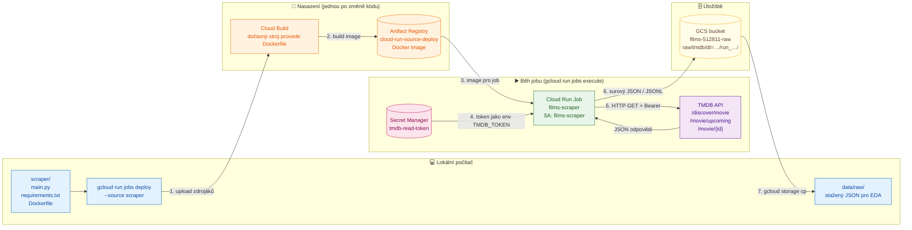
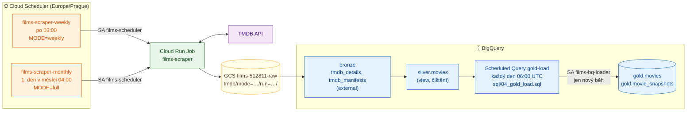
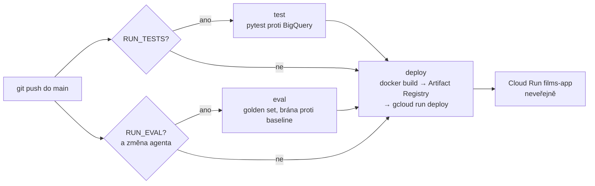

# films

Serverless aplikace nad daty o filmech z TMDB API, která běží na Google Cloud Platform.
Projekt nahrazuje starší Azure verzi (Databricks + ADLS), která je vypnutá, protože byla zbytečně složitá a drahá. Její kód je ve složce `old/` a slouží jen jako reference.

## Cílová architektura

```
TMDB API ──► Cloud Run Job (měsíčně, Cloud Scheduler)
                 │
                 ├─► GCS raw bucket (surový JSON)
                 └─► BigQuery staging ──MERGE──► BigQuery finální tabulka
                                                        │
Uživatel ──► Streamlit na Cloud Run ──► Gemini (function calling) ──► SQL nástroje ──┘

GitHub push ──► GitHub Actions ──► build image ──► deploy na Cloud Run
```

## Zdroje dat a filtry

Všechna data jsou z TMDB API. Parametry jsou v `scraper/config.toml` a celá konfigurace každého běhu je uložená v jeho `manifest.json`.

### Odkud se filmy berou

| | **Top 10k** | **Kina** | **Novinky** |
|---|---|---|---|
| Endpoint | `/movie/top_rated` | `/movie/now_playing` a `/movie/upcoming` | `/discover/movie` |
| Co obsahuje | nejlépe hodnocené filmy TMDB | co teď běží a co přijde do kin | nově vydané a chystané filmy (kino, streaming, festival) |
| **Filtry při stahování** (v API) | žádné vlastní. Řazení podle `vote_average` a minimální počet hlasů určuje TMDB, adult je vyřazený | `region` = **US, CZ** (země kina) | **země původu** (`with_origin_country`) = 23 zemí, **premiéra** od −30 do +90 dní od dne běhu, `include_adult=false`, `include_video=false` |
| Co se **nefiltruje** | země, rok, délka filmu | země původu (všechny filmy, které tam hrají), délka | délka filmu, počet hlasů, popularita |
| Rozsah | 500 stránek = max. 10 000 filmů | všechny stránky pro každý region | všechny stránky pro každou zemi. Pokud dotaz přesáhne 10 000 výsledků, rozsah dat se dělí |
| Režim | `full` (1× měsíčně) | `full` i `weekly` (1× týdně) | `full` i `weekly` (1× týdně) |
| Parametry v `config.toml` | `[top_rated] pages` | `[cinema] regions` | `[new_releases] countries, days_back, days_ahead, include_adult, include_video` |
| Značka v `_sources` | `top_rated` | `now_playing:US`, `upcoming:CZ` … | `new_release:FR` … |
| Filmů v 1. běhu (2026-10-26) | 9 922 | 774 unikátních (US běží 586 / přijde 116, CZ běží 76 / přijde 43) | 5 074 unikátních (US 2 302, FR 455, GB 382, DE 309, ES 275 …, SK 12) |

Země pro novinky (23): `US, GB, CA, AU, IE, NZ`, `CZ, SK`, `FR, DE, IT, ES, BE, NL, AT, CH, DK, SE, NO, FI, PL`, `KR, JP`. CN, IN a HK jsou vyřazené kvůli obrovské lokální produkci.

**Překryvy mezi zdroji (1. běh `full`):** 15 290 unikátních filmů. Jen v top 10k je 9 883 filmů, jen v novinkách 4 632, jen v kinech 297. Kina a novinky sdílejí 441 filmů, top 10k a kina 38, top 10k a novinky 3 (novinky ještě nemají dost hlasů na top 10k). Film ve více zdrojích se stahuje a ukládá jednou, všechny zdroje má v `_sources`.

### Co se děje s každým filmem

| Krok | Kde | Co |
|---|---|---|
| Sloučení | scraper | ID ze všech zdrojů se sloučí, duplicity se odstraní |
| Detail | scraper | `/movie/{id}?append_to_response=credits,keywords,release_dates` |
| Oříznutí `credits` | scraper | cast: prvních 20 herců podle `order`, crew: jen Director, Writer, Screenplay, Novel, Story, Producer, Executive Producer, Director of Photography, Original Music Composer, Editor, Casting (všichni lidé v roli). Ostatní pole beze změny |
| Přidaná pole | scraper | `_sources` (ze kterých zdrojů film přišel) a `_fetched_at` (čas stažení) |
| Uložení | GCS | JSONL po částech v `tmdb/mode=…/run=…/`, `manifest.json` jako poslední |
| Čištění | BigQuery (zatím nehotové) | `runtime ≥ 40`, `0` a prázdné hodnoty → `NULL`, typy, pole. V raw zůstává všechno |

## Rozhodnutí

- **Nejdřív lokálně, cloudové služby naostro.** Kód běží lokálně a volá skutečné služby v GCP (BigQuery, GCS, Gemini na Vertex AI). Na Cloud Run se později přesune stejný kód beze změn.
- **Gemini přes Vertex AI, ne přes AI Studio API klíč.** Přihlášení přes Application Default Credentials: lokálně `gcloud auth application-default login` (tvůj účet), na Cloud Runu service account. V kódu ani v `.env` nejsou žádné klíče.
  ```python
  from google import genai
  client = genai.Client(vertexai=True, project="<PROJECT_ID>", location="us-central1")
  ```
- **Žádné tajné údaje v repu.** TMDB klíč patří do Secret Manageru, GitHub Actions se přihlašují přes Workload Identity Federation (bez JSON klíče).
- **Náklady.** Region `us-central1` kvůli free tieru a budget alert hned při zakládání projektu. Volání Gemini se platí i při lokálním vývoji.
- **Jedno repo, oddělené CI/CD pro ETL a aplikaci.** GitHub repo je jediný zdroj pravdy pro kód. Každá část má vlastní workflow, které se spustí jen při změně jejích souborů:
  ```
  films/
  ├── scraper/                 ← ETL (Cloud Run Job)
  ├── app/                     ← Streamlit + Gemini (Cloud Run Service)
  ├── sql/                     ← BigQuery tabulky, MERGE
  └── .github/workflows/
      ├── deploy-scraper.yml   ← jen při změně scraper/**
      └── deploy-app.yml       ← jen při změně app/**
  ```
  ```yaml
  on:
    push:
      branches: [main]
      paths: ["scraper/**", ".github/workflows/deploy-scraper.yml"]
  ```
  - Části se nasazují nezávisle, takže chyba v buildu aplikace neblokuje ETL a naopak.
  - Schéma BigQuery, scraper i aplikace jsou v jednom repu, takže změna schématu je v jednom commitu.
  - Přihlášení GitHub Actions do GCP (Workload Identity Federation) se nastaví jednou pro celé repo.
  - Za běhu má každá část vlastní service account s minimálními právy: `films-scraper` (secret TMDB, zápis do bucketu) a `films-app` (čtení z BigQuery, Vertex AI). Aplikace k TMDB tokenu přístup nemá.
- **Strategie scrapingu: tři zdroje filmů a vždy plné stažení.** Původní plán (všechny filmy z vybraných zemí přes `discover`) se ukázal jako příliš velký: jen US od roku 1920 má přes 100 tisíc filmů, celkem odhadem 350–450 tisíc, většinou bez hlasů. Starý projekt pracoval s ~10 tisíci (Kaggle top 10k a upcoming). Nově se stahují tři zdroje (top 10k, kina a novinky), sloučí se podle `id` a ke každému filmu se stáhne detail. Přehled zdrojů, filtrů a čísel je v sekci [Zdroje dat a filtry](#zdroje-dat-a-filtry).

  - **Top 10k se mění pomalu** (hlasování uživatelů TMDB, nové filmy se do něj dostanou po měsících), proto stačí měsíčně. Kina a novinky se mění každý týden.
  - **Země pro novinky (23):** `US, GB, CA, AU, IE, NZ`, `CZ, SK`, `FR, DE, IT, ES, BE, NL, AT, CH, DK, SE, NO, FI, PL`, `KR, JP`. CN, IN a HK jsou vyřazené kvůli obrovské lokální produkci. Jejich světově známé filmy zachytí top 10k nebo kina v US.
  - **`release_dates`** obsahuje datum premiéry pro každou zemi a typ vydání (kino, digitál, TV), takže je známé, kdy film přijde do kin v ČR.
  - Každý detail má `_sources`, tedy ze kterých zdrojů film přišel (například `top_rated`, `now_playing:US`, `upcoming:CZ`, `new_release:FR`), a `_fetched_at`.
  - **Filtry ze starého projektu** (`runtime ≥ 40`, převod `0` a prázdných hodnot na `NULL`) se uplatní až při čištění v BigQuery. V raw zůstává všechno, co zdroje vrátily.
  - **Všechny parametry jsou v `scraper/config.toml`** (v repu, s komentáři): zdroje a režimy, regiony kin, země a okno novinek, oříznutí, výstup, API a pojistky. Změna = úprava souboru a nové nasazení jobu. Celá konfigurace se kopíruje do `manifest.json` každého běhu. Režim a testovací limity se nastavují proměnnými prostředí (`MODE`, `MAX_MOVIES`, `TOP_RATED_PAGES`).
  - **Oříznutí `credits` už ve scraperu**, všechno ostatní zůstane, jak to TMDB vrátilo: cast prvních 20 herců podle `order`, crew jen klíčové role (Director, Writer, Screenplay, Novel, Story, Producer, Executive Producer, Director of Photography, Original Music Composer, Editor, Casting) se všemi lidmi v roli.
  - **Scraper je nezávislý na BigQuery.** Jen stahuje do GCS a nic nečte ani nezapisuje do BigQuery.
- **Raw bucket: každý běh má vlastní složku a ukládá se po částech.**
  ```
  films-512811-raw/
  └── tmdb/                                   # zdroj dat (místo pro případné další zdroje)
      ├── mode=full/run=YYYY-MM-DDTHH-MM-SSZ/
      └── mode=weekly/run=YYYY-MM-DDTHH-MM-SSZ/
              lists/part-0001.jsonl     # surové stránky seznamů (se zdrojem a dotazem)
              details/part-0001.jsonl   # max. 1 000 filmů na část, nahrává se průběžně
              manifest.json             # zapisuje se jako poslední = běh je úplný
  ```
  Jen 4 úrovně. Prefix `raw/` by zdvojoval název bucketu a složka `dt=` by zdvojovala datum, které je v `run=`. Složky ve tvaru `klíč=hodnota` čte BigQuery automaticky jako sloupce `mode` a `run` (hive partitioning). Pole přidaná scraperem (`_sources`, `_fetched_at`) mají podtržítko, aby se odlišila od polí z TMDB.
  **Formát raw je JSONL, ne Parquet.** Je to přesná kopie odpovědi TMDB, nové nebo prázdné pole nezpůsobí konflikt schémat mezi částmi a scraper nepotřebuje `pyarrow`. Sloupcové uložení zajistí až nativní tabulky BigQuery. Pokud by objem dat byl větší, než se čeká, zapne se gzip (`.jsonl.gz`), který BigQuery čte přímo.

  Lifecycle pravidlo bucketu maže soubory starší než 160 dní, takže zůstává zhruba posledních 5 měsíčních běhů. Mazání řídí GCP, job nepotřebuje právo mazat.
- **BigQuery ve vrstvách bronze → silver → gold (medallion), každá vrstva má vlastní dataset.** Oddělené datasety umožní dát aplikaci (`films-app`) přístup jen ke `gold`.

  | Dataset | Objekt | Typ | Obsah |
  |---|---|---|---|
  | `bronze` | `tmdb_details`, `tmdb_manifests` | external tables | surová data z GCS, jak přišla z TMDB |
  | `silver` | `movies` | view | vyčištěné filmy z posledního úplného běhu (`sql/02_silver_movies.sql`) |
  | `gold` | `movies`, `movie_snapshots` | tabulky | finální katalog (`MERGE`) a historie pro aplikaci a Gemini |

  Čištění bronze → silver: `0` a prázdné texty → `NULL` (`runtime`, `budget`, `revenue`, `overview`, `tagline`, `homepage`), `vote_average` → `NULL` bez hlasů, `release_date` → `DATE`, `poster_path` → celá URL, seznamy objektů → seznamy jmen (žánry, keywords, společnosti, země, jazyky), štáb rozdělený na `directors`, `writers`, `producers`, `cinematographers`, `composers`, `editors`, herci jako `top_cast` (jméno, postava, pořadí), `release_date_cz` a `release_date_us` (kino premiéra), příznaky zdrojů (`is_top_rated`, `in_cinema_us/cz`, `upcoming_us/cz`, `is_new_release`). Vynechá se `adult` a `backdrop_path`. Řádky: jen poslední úplný běh, každý film jednou. **Filtr kvality:** top 10k projde vždy, novinky a kina jen s popisem, plakátem a `runtime ≥ 40` nebo neznámým.
- **Načítání do BigQuery čistě přes SQL.** External table nad raw bucketem a Scheduled Query (po každém běhu scraperu) vezme poslední úplný běh (s `manifest.json`), vyčistí ho a:
  - `MERGE` do `gold.movies`: 1 řádek na film, aktuální stav (tabulka roste jen s počtem filmů, ne s počtem běhů). Zdroje jsou jako příznaky: `is_top_rated` mění jen běh `full` (týdenní běh top 10k nestahuje, jinak by ho „vyřadil“), `in_cinema_*`, `upcoming_*` a `is_new_release` mění každý běh. `in_catalog` znamená, že film je aspoň v jednom zdroji. Filmy se nemažou. Časové sloupce:
    - `first_seen_at`: první běh, ve kterém se film objevil. Nastaví se jednou a `MERGE` ho nikdy nepřepíše, takže „novinky v měsíci“ jdou filtrovat kdykoli zpětně. V prvním běhu ho dostanou všechny existující filmy, takže smysluplné novinky jsou až od druhého běhu.
    - `last_seen_at`: poslední běh, ve kterém film byl.
    - `updated_at`: kdy `MERGE` řádek naposledy změnil.
  - `INSERT` do `gold.movie_snapshots`: 1 řádek na film a běh (`run_at, run, run_mode, id, title, status, release_date, release_date_cz, release_date_us, vote_average, vote_count, popularity, sources` a příznaky zdrojů). Slouží pro historii metrik, změny stavu (`Post Production` → `Released`), posuny premiér a historii kin (kdy film začal hrát a kdy zmizel, s týdenní přesností). Je to kolem 120–150 tisíc malých řádků ročně.
  - **`movie_snapshots` se nikdy nemaže ani nepřestavuje z raw.** Je to trvalý záznam historie, protože raw drží jen ~5 měsíců. Kdyby se `movies` přestavovala, `first_seen_at` se dopočítá jako `MIN(run_date)` ze snapshotů.
  - Opakované spuštění nic nerozbije, protože `MERGE` je idempotentní.

- **Kill switch přes GCP Spend caps (Billing → Budgets & caps), stejně jako u book_recommenderu.** GCP při dosažení měsíční částky sám pozastaví danou službu, bez vlastního kódu.
  - Omezení: jeden cap platí pro jeden projekt a jednu službu. Podporované jsou Cloud Run, Cloud Run Functions, Gemini API a Vertex AI. Vypnutí není okamžité, takže cap se nastavuje trochu pod skutečný limit a co se utratí navíc, se zaplatí.
  - **Cloud Run** (scraper, později aplikace): cap nastavit hned.
  - **Vertex AI** (Gemini): cap ve fázi II (krok 2.7). Druhý budget s capem v jednom projektu jde, každý na jinou službu.
  - BigQuery, Cloud Storage a Cloud Build spend cap nemají. Jsou ve free tieru a hlídá je e-mailový alert v budgetu a `maximum_bytes_billed` u dotazů v BigQuery.
  - Ruční okamžité zastavení: **Cancel** u běžícího spuštění jobu v konzoli (nebo `gcloud run jobs executions cancel`). Vlastní skript na vypínání se nedělá, aby nevznikaly dva systémy vedle sebe.
  - Scraper má navíc vlastní pojistky (`max_runtime_minutes`, circuit breaker po opakovaných chybách), které chrání i TMDB API před zbytečnou zátěží.

## Roadmap

- [ ] **Fáze 0:** lokální prostředí (uv venv, struktura repa, `.gitignore`), GCP projekt (přihlášení přes `gcloud`, zapnutí API včetně `aiplatform.googleapis.com`, budget alert)
- [x] **Fáze I:** GCS raw bucket, BigQuery dataset a tabulky, MERGE, extrakční job (hotovo 2026-10-26)
  - [x] Secret, bucket a service account (krok 1.1)
  - [x] Vzorový scraping jako Cloud Run Job (krok 1.2)
  - [x] EDA surových dat (krok 1.3)
  - [x] Přepis scraperu podle strategie a test na jednom roce `CZ` (krok 1.4)
  - [x] Ostrý běh na `CZ` (krok 1.4)
  - [x] ~~Plný běh pro všech 26 zemí~~ zrušen po 14 minutách, katalog byl příliš velký (viz Rozhodnutí)
  - [x] Scraper se třemi zdroji (top 10k, kina US/CZ, novinky 23 zemí), režimy `full` a `weekly` (krok 1.5)
  - [x] Ostrý běh `weekly` a `full` (krok 1.5)
  - [x] Lifecycle pravidla bucketů (raw 160 dní, run-sources 30 dní) a cleanup Artifact Registry (poslední 3 verze) (krok 1.7)
  - [x] BigQuery: dataset `films` a external tables `raw_details`, `raw_manifests` (krok 1.8)
  - [x] BigQuery: přejmenování na vrstvy `bronze` / `silver` / `gold`. Datasety vytvořené, `bronze.tmdb_details` a `bronze.tmdb_manifests` přes `sql/01_bronze_tmdb_external_tables.sql`, starý dataset `films` ručně smazaný v konzoli (2026-10-26)
  - [x] BigQuery: `silver.movies`, čištění a filtr kvality (`sql/02_silver_movies.sql`, krok 1.9)
  - [x] BigQuery: `gold.movies` (`MERGE`) a `gold.movie_snapshots` (`INSERT`) (krok 1.10)
  - [x] Automatizace: Cloud Scheduler (scraper týdně a měsíčně) a Scheduled Query `gold-load` (denně, načte jen nový běh) (krok 1.11)
  - [x] Budget `films-cloud-run` se spend capem na Cloud Run, 100 Kč měsíčně (krok 1.12)
  - [x] Pojistky ve scraperu (`max_runtime_minutes`, circuit breaker) (krok 1.5)
- [ ] **Fáze II:** Streamlit aplikace a Gemini agent s function callingem nad BigQuery, vyvíjené lokálně proti Vertex AI v GCP
  - [x] Závislosti pro aplikaci a agenta (krok 2.1)
  - [x] Vertex AI API a lokální přihlášení přes ADC (krok 2.2)
  - [x] Minimální agent: Streamlit chat, Gemini vybírá funkci, jedna funkce `search_by_genre` (krok 2.3)
  - [x] Jedna obecná funkce `search_movies` s filtry (žánry, roky, hodnocení, osoba, kina, premiéra, znovuuvedení, řazení) (krok 2.4)
  - [x] Validace: testy funkce, golden set a evaluace agenta s metrikami, první ladění popisů (krok 2.5)
  - [x] Úpravy UI: Film Agent, karty dotazů, ukázkové prompty, cena v CZK se součtem session, Clear history, patička s verzí a TMDB (krok 2.6)
  - [x] Budget `films-vertex` se spend capem na Vertex AI, 50 Kč měsíčně (krok 2.7)
  - [ ] Plakáty nalezených filmů (`poster_url` z `gold.movies`, TMDB velikost `w185`): nejdřív sloupec s obrázkem v tabulce (`column_config.ImageColumn`), později mřížka karet s přepínačem tabulka / plakáty. Náhradní obrázek pro filmy bez plakátu. Obrázky načítá prohlížeč přímo z TMDB, do modelu nejdou.
- [x] **Fáze III:** Dockerfile a nasazení aplikace na Cloud Run. Image staví GitHub Actions, lokální Docker se neinstaluje. (hotovo 2026-10-29)
  - [x] Dockerfile a `.dockerignore`, závislosti pro EDA v samostatné skupině (krok 3.1)
  - [x] Service account `films-app` pro aplikaci: čtení `gold`, dotazy do BigQuery, Gemini (krok 3.2)
  - [x] Service account `github-deployer` pro GitHub Actions: nasazení aplikace, testy a evaluace (krok 3.3)
  - [x] Workload Identity Federation: přihlášení GitHub Actions do GCP bez klíčů, jen repo `martincho48/films` a větev `main` (krok 3.4)
  - [x] Workflow `deploy-app.yml`: build, push, deploy na Cloud Run, volitelné testy a evaluace s bránou proti baseline. Aplikace běží neveřejně. (krok 3.5)
- [ ] **Fáze IV:** CI/CD pro zbytek projektu
  - [ ] `deploy-scraper.yml` (`scraper/**` → image, Cloud Run Job `films-scraper`)
  - [ ] `deploy-sql.yml` (`sql/**` → dry run, nasazení SQL)
  - [ ] Zapnout testy a evaluaci v `deploy-app.yml` (`RUN_TESTS`, `RUN_EVAL`)
  - [ ] Zveřejnění aplikace: atribuce TMDB s logem, limity nákladů, `allUsers` jako `run.invoker`

## Analýza starého scrapingu (`old/`)

| Skript | Endpoint | Co stahuje |
|---|---|---|
| `TMDB_films_api/api_TMDB_upcoming_films/extract_upcoming.ipynb`, `azure_pipeline_films/scrape_data.py` | `GET /movie/upcoming` (stránkování, `language=en-US`) | seznam chystaných filmů: `id, title, original_title, original_language, overview, release_date, popularity, vote_average, vote_count, genre_ids, poster_path, backdrop_path, adult, video` (zhruba 719 filmů) |
| totéž + `api_TMDB_released_films/extract_credits.ipynb` | `GET /movie/{id}?append_to_response=credits` (jeden dotaz na film) | `budget, revenue, runtime, tagline, genres[], production_companies[], production_countries[], spoken_languages[]`, `crew` jako slovník `{job: name}`, `cast[]` (jména) |
| `api_TMDB_released_films/input/10k_main.csv` | není ve skriptech (podle odkazů v notebooku z Kaggle) | 10 tisíc nejlépe hodnocených filmů včetně `Keywords` |

Zjištěné problémy, které se do nové verze nepřenesou:
- `scrape_data.py`: `return df` je uvnitř `while`, takže se stáhla jen první stránka `/movie/upcoming`.
- Při chybě se pokračuje s `data` z předchozího filmu, takže vznikají duplicity a chybná data (v `df_credits.csv` je například `id 1303578` dvakrát).
- `crew` jako `{job: name}` přepisuje lidi se stejnou rolí, z několika producentů zůstane jen poslední.
- Nekontroluje se HTTP status a chybí retry na `429` a `5xx`.
- `api_key` se posílá v URL a kód zároveň používá Bearer token.
- Data se zplošťují ještě před uložením, surová odpověď se nikde neuchovává.
- `vote_average` se přetypovává na `int`.

## Postup krok za krokem

Sem se zapisují jen kroky, které jsou skutečně hotové a ověřené.

### Krok 0.1 – Nástroje

- Region GCP: `us-central1` (kvůli free tieru GCS).
- `uv` 0.11.16 je nainstalovaný.
- Google Cloud SDK 590.0.1 (`gcloud`, `bq`, `gsutil`) je nainstalovaný přes winget:
  ```powershell
  winget install --id Google.CloudSDK --exact --source winget
  ```
  Instaluje se do `%LOCALAPPDATA%\Google\Cloud SDK\google-cloud-sdk\bin`. Po instalaci je potřeba úplně restartovat VS Code (ne jen otevřít nový terminál), aby se načetl `PATH`.

### Krok 0.3 – Lokální venv `uv_films`

Venv je mimo repo v `C:\Users\mabilek\uv_all_venvs\uv_films` (Python 3.12.10). Závislosti jsou v `pyproject.toml` a `uv.lock`. Slouží jen pro lokální práci (EDA, později Streamlit). Cloud Run Job ho nepoužívá, má vlastní `scraper/requirements.txt` v Docker image.

```powershell
uv venv C:\Users\mabilek\uv_all_venvs\uv_films --python 3.12
$env:UV_PROJECT_ENVIRONMENT = "C:\Users\mabilek\uv_all_venvs\uv_films"
uv init --bare --name films --python 3.12
uv add pandas pyarrow matplotlib ipykernel
```

`uv` jinak instaluje do `.venv` ve složce projektu. Proto se v každém novém terminálu nastaví `UV_PROJECT_ENVIRONMENT` (případně se venv aktivuje a použije `uv add --active` nebo `uv sync --active`):
```powershell
$env:UV_PROJECT_ENVIRONMENT = "C:\Users\mabilek\uv_all_venvs\uv_films"
uv sync
```
Ve VS Code se jako interpreter i kernel pro notebook vybere `C:\Users\mabilek\uv_all_venvs\uv_films\Scripts\python.exe`.

### Krok 0.2 – GCP projekt

- Projekt: `films-512811` (číslo projektu `188138853287`), billing je napojený.
- Přihlášení:
  ```bash
  gcloud auth login
  ```
  ADC (`gcloud auth application-default login`) zatím není potřeba. Scraping běží jen v Cloud Run Jobu pod service accountem a EDA se dělá nad staženými soubory. ADC se nastaví až ve chvíli, kdy bude lokální Python přímo volat GCP (Streamlit, Gemini).
- Výchozí konfigurace:
  ```bash
  gcloud config set project films-512811
  gcloud config set run/region us-central1
  ```
- Zapnutá API:
  ```bash
  gcloud services enable run.googleapis.com secretmanager.googleapis.com storage.googleapis.com artifactregistry.googleapis.com cloudbuild.googleapis.com
  ```
  BigQuery API je v novém projektu zapnuté automaticky.

### Krok 1.1 – Secret, bucket a service account pro scraping

- **Secret `tmdb-read-token`**: obsahuje TMDB API Read Access Token (Bearer). Vytváří se ručně v konzoli (Secret Manager → Create secret), aby se token nedostal do historie terminálu, do repa ani do chatu.
- **Bucket `gs://films-512811-raw`**: region `us-central1`, uniform bucket-level access, veřejný přístup zakázaný.
  ```bash
  gcloud storage buckets create gs://films-512811-raw --location=us-central1 --uniform-bucket-level-access --public-access-prevention
  ```
- **Service account `films-scraper@films-512811.iam.gserviceaccount.com`**: identita Cloud Run Jobu, s minimálními právy jen na konkrétní zdroje.
  ```bash
  gcloud iam service-accounts create films-scraper --display-name="Films TMDB scraper (Cloud Run Job)"
  gcloud secrets add-iam-policy-binding tmdb-read-token \
    --member=serviceAccount:films-scraper@films-512811.iam.gserviceaccount.com \
    --role=roles/secretmanager.secretAccessor
  gcloud storage buckets add-iam-policy-binding gs://films-512811-raw \
    --member=serviceAccount:films-scraper@films-512811.iam.gserviceaccount.com \
    --role=roles/storage.objectCreator
  ```
  `objectCreator` umí soubory jen vytvářet, ne číst ani mazat. To stačí, protože každý běh zapisuje nové soubory s časovým razítkem.

### Krok 1.2 – Scraping jako Cloud Run Job (vzorek dat)

Kód je ve složce `scraper/` (`main.py`, `requirements.txt`, `Dockerfile`).

- Stahuje `/discover/movie` (řazeno podle popularity, bez adult obsahu) a `/movie/upcoming`, z nich vybere unikátní ID a pro každé zavolá `/movie/{id}?append_to_response=credits,keywords`.
- Odpovědi ukládá **beze změn** do GCS:
  ```
  gs://films-512811-raw/raw/tmdb/dt=YYYY-MM-DD/run_YYYY-MM-DDTHH-MM-SSZ/
      discover_page_001.json    # surová stránka /discover/movie
      upcoming_page_001.json    # surová stránka /movie/upcoming
      movie_details.jsonl       # 1 řádek = 1 detail filmu včetně credits a keywords
      manifest.json             # metadata běhu (počty, chyby)
  ```
- Bearer token jde z Secret Manageru přes `--set-secrets`, takže v kódu ani v image žádný není. Při `429` a `5xx` se dotaz opakuje, film s chybou se zaloguje a přeskočí.
- Počet stránek se nastavuje proměnnými `DISCOVER_PAGES` a `UPCOMING_PAGES` (1 stránka = 20 filmů).

#### Jak funguje nasazení a běh jobu



- **Cloud Build** sestaví Docker image v cloudu, takže lokálně není potřeba Docker Desktop. Free tier je zhruba 2 500 build-minut měsíčně a jeden build trvá kolem 1 až 2 minut.
- **Artifact Registry** je úložiště Docker imagí. Repo `cloud-run-source-deploy` vytvoří `gcloud` automaticky při prvním nasazení. Free tier je 0,5 GB a staré verze imagí se hromadí, takže časem nastavíme jejich automatické mazání.
- Ve fázi IV bude kroky 1 až 3 dělat GitHub Actions při každém `git push`.

#### Co je Docker image a proč ho potřebujeme

Cloud Run je cizí počítač v Googlu, který nemá náš Python, knihovny ani kód. **Image je zabalený „mini počítač“** se vším, co scraper ke spuštění potřebuje. Každý řádek `scraper/Dockerfile` přidá jednu vrstvu:

```
┌─────────────── image (~19 MB) ───────────────┐
│  3. náš kód:         main.py, config.toml   │  ← COPY main.py config.toml ./
│  2. knihovny:        requests, google-cloud │  ← RUN pip install -r requirements.txt
│  1. základ:          Linux + Python 3.12    │  ← FROM python:3.12-slim
│  příkaz po startu:   python main.py         │  ← CMD ["python", "main.py"]
└─────────────────────────────────────────────┘
```

Přirovnání k jídlu:
- `Dockerfile` je **recept**,
- **image** je **hotové zamrazené jídlo**: uvaří ho jednou Cloud Build a uloží do „mrazáku“, tedy Artifact Registry,
- **spuštění jobu** je **ohřátí porce**: Cloud Run z image vytvoří běžící kontejner, spustí `python main.py`, ten stáhne filmy do bucketu a kontejner se zahodí. Další běh vezme stejný image, nic se znovu neinstaluje.

Důležité:
- **`config.toml` je uvnitř image.** Změna souboru lokálně se do cloudu nedostane, dokud se znovu nespustí `gcloud run jobs deploy`, tedy dokud se nevyrobí nový image.
- **Každé nasazení vytvoří novou verzi image.** Job vždy používá poslední. Artifact Registry drží poslední 3 verze (krok 1.7) kvůli rychlému návratu zpět.

Nasazení (Cloud Build sestaví image z Dockerfile do Artifact Registry `cloud-run-source-deploy`):
```bash
gcloud run jobs deploy films-scraper --source scraper --region us-central1 \
  --service-account films-scraper@films-512811.iam.gserviceaccount.com \
  --set-secrets "TMDB_TOKEN=tmdb-read-token:latest" \
  --set-env-vars "BUCKET=films-512811-raw,DISCOVER_PAGES=1,UPCOMING_PAGES=1" \
  --max-retries 0 --task-timeout 15m
```

Spuštění, kontrola logů a stažení dat lokálně:
```bash
gcloud run jobs execute films-scraper --region us-central1 --wait
gcloud logging read 'resource.type="cloud_run_job" AND resource.labels.job_name="films-scraper"' --limit 30 --format="value(textPayload)"
gcloud storage cp -r gs://films-512811-raw/raw/tmdb data/raw/
```

První běh (2026-10-26) dopadl takto: 1 stránka discover a 1 stránka upcoming, tedy 40 filmů, z toho 31 unikátních. Detaily se stáhly u všech 31 a žádný neselhal. Data mají 1,37 MiB, z toho 1,4 MB je `movie_details.jsonl` (kolem 45 kB na film, většinu tvoří `credits`). Upcoming má v době běhu 88 stránek. Složky `data/` a `old/` jsou v `.gitignore`.

### Krok 1.3 – EDA surových dat

Notebook `eda/01_raw_tmdb.ipynb` (kernel `uv_films`) načte nejnovější běh z `data/raw/tmdb/` a projde manifest, oba seznamy filmů, ploché sloupce (null, prázdné a nulové hodnoty, rozdělení), vnořená pole, credits a keywords a velikost dat. Závěry jsou v poslední sekci notebooku.

Hlavní zjištění ze vzorku 31 filmů:
- `/movie/upcoming` bez `region` vrací hlavně už vydané filmy (jen 2 z 20 jsou po dni běhu).
- `/discover/movie` hlásí 1001 stránek, ale TMDB vrací nejvýš 500, takže plný katalog je potřeba stahovat po řezech (například po letech).
- `budget` a `revenue` = 0 (9 z 31) a `vote_average` = 0 při `vote_count` = 0 znamenají „neznámé“, tedy `NULL`. Prázdné `tagline` a `homepage` také → `NULL`.
- `credits` tvoří 96 % objemu (44 kB na film, z toho 76 % crew s 384 různými joby). Do BigQuery půjdou jen klíčové role jako `ARRAY` na roli (až 2 režiséři, až 12 producentů) a prvních N herců podle `order`.
- `adult`, `video` a `softcore` jsou vždy `False`, takže se vynechají.

Do venv přibyly dev závislosti `nbclient` a `nbformat` pro spuštění notebooku z příkazové řádky (`uv add --dev nbclient nbformat`).

### Krok 1.4 – Scraper podle strategie, test na `CZ`

Scraper (`scraper/main.py`) je přepsaný podle sekce Rozhodnutí. Všechny parametry jsou v `scraper/config.toml` s komentáři:
- `[discover]`: země, `min_runtime`, `year_from`, `years_ahead`, adult/video, jazyk textů,
- `[trim]`: `cast_top_n` a `crew_jobs`,
- `[output]`: prefix, velikost částí, gzip,
- `[api]`: `workers` a `max_requests_per_second`.

Jak scraper funguje:
- Pro každou zemi stáhne `/discover/movie` přes celý rozsah dat vydání. Pokud má rozsah víc než 10 000 výsledků (limit TMDB), rozdělí ho napůl a pokračuje, dokud se nevejde.
- Detaily stahuje paralelně (8 vláken) se společným stropem 30 dotazů za sekundu a při `429` nebo `5xx` dotaz zopakuje.
- Výstup nahrává průběžně po částech. Každý detail má pole `_fetched_at`. Celá konfigurace a počty jdou do `manifest.json`.

Nasazení (`--task-timeout 6h`, `--memory 1Gi`) a testovací spuštění s přepsanými parametry:
```bash
gcloud run jobs deploy films-scraper --source scraper --region us-central1 \
  --service-account films-scraper@films-512811.iam.gserviceaccount.com \
  --set-secrets "TMDB_TOKEN=tmdb-read-token:latest" --set-env-vars "BUCKET=films-512811-raw" \
  --max-retries 0 --task-timeout 6h --memory 1Gi
gcloud run jobs execute films-scraper --region us-central1 --update-env-vars "COUNTRIES=CZ,YEAR_FROM=2024,YEAR_TO=2024" --wait
gcloud run jobs execute films-scraper --region us-central1 --update-env-vars "COUNTRIES=CZ" --async
```

Výsledky (2026-10-26):
| Běh | Filmů | Chyb | Doba | details | lists |
|---|---|---|---|---|---|
| CZ 2024 | 145 | 0 | 6 s | 1 soubor, 0,77 MB | 1 soubor, 0,11 MB |
| CZ 1900–2028 | 2 910 | 0 | 115 s | 3 soubory, 16,6 MB (~5,7 kB na film) | 1 soubor, 2,1 MB |

Oříznutí credits ověřené na vzorku z kroku 1.2: z 44,3 kB na 12,2 kB na film u populárních filmů. U celého CZ katalogu je to ~5,7 kB na film, protože méně známé filmy mají menší štáb.

### Krok 1.5 – Scraper se třemi zdroji, režimy `full` a `weekly`

Plný běh přes `discover` pro 26 zemí od roku 1920 byl po 14 minutách zrušen (`gcloud run jobs executions cancel`): jen US do roku 2011 dalo ~107 tisíc filmů, celkový odhad byl 350–450 tisíc a hrozilo překročení časového limitu jobu. Strategie se změnila na tři zdroje (viz Rozhodnutí): top 10k, kina US/CZ a novinky z 23 zemí. Testovací a zrušené běhy jsou z bucketu smazané.

Scraper (`scraper/main.py`, `scraper/config.toml`):
- `[modes]` určuje, které zdroje se stahují v režimu `full` a `weekly`. Režim se volí proměnnou `MODE`.
- Detail se stahuje s `append_to_response=credits,keywords,release_dates`. Každý film má `_sources` a `_fetched_at`.
- Pojistky `[safety]`: `max_runtime_minutes = 120` a `max_consecutive_failures = 50`. Při překročení se běh ukončí bez `manifest.json`.
- Cesta v bucketu: `tmdb/mode=…/run=…/` (oba běhy z 2026-10-26 jsou přesunuté ze staršího tvaru `raw/tmdb/mode=…/dt=…/run=…/` přes `gcloud storage mv` a jejich manifesty mají opravené cesty).

```bash
gcloud run jobs deploy films-scraper --source scraper --region us-central1 \
  --service-account films-scraper@films-512811.iam.gserviceaccount.com \
  --set-secrets "TMDB_TOKEN=tmdb-read-token:latest" --set-env-vars "BUCKET=films-512811-raw" \
  --max-retries 0 --task-timeout 3h --memory 1Gi
gcloud run jobs execute films-scraper --region us-central1 --update-env-vars "MODE=weekly" --wait
gcloud run jobs execute films-scraper --region us-central1 --update-env-vars "MODE=full" --async
```

Výsledky (2026-10-26):
| Běh | Filmů (unikátních) | Chyb | Doba | Velikost | Souborů |
|---|---|---|---|---|---|
| `weekly` | 5 407 | 0 | 3,5 min | ~29 MB (~4,7 kB na film v detailech) | 7 + manifest |
| `full` | 15 290 | 0 | 9,5 min | 204 MB (~13 kB na film) | 18 + manifest |

Filmy podle zdroje: top 10k 9 922 (TMDB během stránkování mírně přeřazuje pořadí, proto méně než 10 000), kina: US běží 586 / přijde 116, CZ běží 76 / přijde 43, novinky (−30 až +90 dní) celkem 5 278, z toho US 2 302, FR 455, GB 382, DE 309, ES 275, CA 229, IT 227, JP 177, NL 150, KR 139, AU 119, CZ 81, BE 81, PL 61, SE 56, CH 51, IE 42, AT 31, NO 26, FI 26, DK 24, NZ 23, SK 12.

### Krok 1.6 – EDA dat z běhu `full`

Notebook `eda/01_raw_tmdb.ipynb` je přepsaný na data z běhu `full` (2026-10-26, 15 290 filmů). Data jsou lokálně v `data/raw/tmdb/mode=full/run=…/`, stažená přes `gcloud storage cp -r gs://films-512811-raw/tmdb/mode=full/run=… data/raw/tmdb/mode=full`. Původní EDA vzorku 31 filmů zůstává v historii gitu.

Notebook prochází počty podle zdroje, chybějící a nulové hodnoty, počet hlasů, délku, rok vydání, žánry, jazyky, země, status, CZ premiéru z `release_dates` a velikost záznamu.

Hlavní zjištění:
- **Top 10k je čistý.** Minimum je 300 hlasů (práh TMDB), popis i plakát má skoro každý film a `runtime < 40` jen 1,6 %.
- **Novinky jsou z velké části šum.** 92,7 % bez hlasu, 69,7 % `runtime < 40` (26 % neznámá délka), 16 % bez popisu, 26 % bez herců a ~1 200 filmů ještě ve výrobě nebo plánu.
- **Kina mají taky šum.** Filmy jen z kin: 62 % bez hlasu, 44 % `runtime < 40`. Kino premiéru v CZ má jen 12–22 % filmů z kin.
- U novinek a kin bude potřeba filtr na kvalitu (délka, popis, plakát, popularita nebo hlasy). O tom se rozhodne při čištění v BigQuery.
- JSONL se musí číst po řádcích `\n`, ne přes `splitlines()`, protože texty obsahují znaky jako U+2028.

### Krok 1.7 – Automatický úklid úložišť

| Úložiště | Pravidlo | Proč |
|---|---|---|
| `gs://films-512811-raw` | smazat soubory starší než **160 dní** | zůstane ~5 měsíčních a ~23 týdenních běhů, ustálený stav ~1,7 GB (free tier 5 GB) |
| `gs://run-sources-films-512811-us-central1` | smazat soubory starší než **30 dní** | zipy zdrojáků jsou po sestavení image zbytečné |
| Artifact Registry `cloud-run-source-deploy` | ponechat **poslední 3 verze** image, starší smazat | job používá jen poslední. 3 verze kvůli rychlému návratu zpět a pro případ, že nasazení selže po nahrání image (~60 MB, free tier 0,5 GB) |

```bash
# lifecycle-160.json: {"rule":[{"action":{"type":"Delete"},"condition":{"age":160}}]}
gcloud storage buckets update gs://films-512811-raw --lifecycle-file=lifecycle-160.json
# lifecycle-30.json:  {"rule":[{"action":{"type":"Delete"},"condition":{"age":30}}]}
gcloud storage buckets update gs://run-sources-films-512811-us-central1 --lifecycle-file=lifecycle-30.json
# ar-cleanup.json: [{"name":"keep-3-most-recent","action":{"type":"Keep"},"mostRecentVersions":{"keepCount":3}},
#                   {"name":"delete-older","action":{"type":"Delete"},"condition":{"tagState":"any"}}]
gcloud artifacts repositories set-cleanup-policies cloud-run-source-deploy --location us-central1 --policy=ar-cleanup.json --no-dry-run
```

Úklid spouští GCP sám na pozadí (obvykle jednou denně), ne okamžitě po nastavení. Stav k 2026-10-26: raw bucket 233 MB, `run-sources` 0,1 MB, Artifact Registry 134 MB (7 verzí, úklid na 3 proběhne sám).

### Krok 1.8 – BigQuery: dataset a external tables nad raw

- **Dataset `films-512811:films`** v `us-central1`:
  ```bash
  bq --location=us-central1 mk --dataset --description "TMDB films: raw external tables and cleaned tables" films-512811:films
  ```
- **External tables** (původně `sql/01_raw_external_tables.sql`, teď `sql/01_bronze_tmdb_external_tables.sql`, viz rozhodnutí o vrstvách bronze/silver/gold). BigQuery čte JSONL přímo z GCS, nic se nekopíruje. `mode` a `run` jsou sloupce z cesty (hive partitioning).
  - `raw_details`: detaily filmů. Schéma má jen pole, která používáme, ostatní se ignorují. Maska `tmdb/*.jsonl` zachytí i `lists/`, proto se filtruje `_FILE_NAME LIKE '%/details/%'`. BigQuery dovoluje jen jednu `*` v cestě.
  - `raw_manifests`: jeden řádek na úplný běh. Scraper teď zapisuje `manifest.json` na jeden řádek, aby šel číst jako JSONL. Oba existující manifesty jsou přepsané.
  ```bash
  bq query --use_legacy_sql=false --location=us-central1 < sql/01_raw_external_tables.sql   # tehdejší název souboru
  ```
  Pozor na Windows PowerShell 5.1: při posílání souboru do `bq` přes `|` přidá BOM a dotaz selže na „Illegal input character \357“. Je potřeba použít přesměrování přes `cmd /c "bq query ... < soubor.sql"`.
- **Ověření** (2026-10-26): `full` 15 290 filmů a `weekly` 5 407 filmů, přesně podle manifestů. Vnořená pole (`credits`, `release_dates`, `_sources`) se načítají a znaky U+2028 v textech BigQuery nevadí.

### Krok 1.9 – Silver: čištění a filtr kvality

View `silver.movies` (`sql/02_silver_movies.sql`) čte z `bronze` poslední úplný běh a čistí ho podle pravidel v sekci Rozhodnutí. Je to jen uložený dotaz, nic se nekopíruje.
```bash
cmd /c "bq query --use_legacy_sql=false --location=us-central1 < sql\02_silver_movies.sql"
```

Postup čištění:

**1. Výběr řádků**
| Pravidlo | Proč |
|---|---|
| jen poslední úplný běh (má `manifest.json`, nejnovější `run`) | starší běhy jsou historie (půjdou do `gold.movie_snapshots`) |
| jen řádky z `details/` (`_FILE_NAME`) | maska `*.jsonl` zachytí i `lists/` |
| každý film jednou (`id`, nejnovější `_fetched_at`) | ochrana proti duplicitám |

**2. Filtr kvality** (jediné místo, kde se zahazují celé filmy)
| Zdroj | Pravidlo |
|---|---|
| Top 10k | projde vždy, bez filtru (EDA: min. 300 hlasů, popis a plakát skoro všude) |
| Kina a novinky | zůstane jen film s **popisem** a **plakátem** a s `runtime ≥ 40` nebo **neznámou délkou** (chystané filmy délku často nemají) |

**3. Oprava hodnot**
| Sloupec | Před (bronze) | Po (silver) | Proč |
|---|---|---|---|
| `budget`, `revenue` | `0` | `NULL` | TMDB hodnotu nezná, nejde o nulu |
| `runtime` | `0` | `NULL` | neznámá délka |
| `vote_average` | `0` při 0 hlasech | `NULL` | film bez hlasů nemá hodnocení 0 |
| `overview`, `tagline`, `homepage` | prázdný text | `NULL` | chybí |
| `release_date` | text, může být prázdný | `DATE`, prázdný → `NULL` | filtrování podle data |

**4. Zjednodušení struktury** (z vnořeného JSON na čitelné sloupce)
| Před (bronze) | Po (silver) |
|---|---|
| `poster_path` `/abc.jpg` | `poster_url` `https://image.tmdb.org/t/p/w500/abc.jpg` |
| `genres`, `keywords`, `production_companies` `[{id, name}]` | seznamy jmen `["Drama", "Crime"]` |
| `production_countries`, `spoken_languages` | seznamy kódů zemí / názvů jazyků |
| `belongs_to_collection` `{id, name, …}` | `collection` (název) |
| `credits.crew` | `directors`, `writers`, `producers`, `cinematographers`, `composers`, `editors` (všichni lidé v roli, bez duplicit) |
| `credits.cast` (20 herců, 12 polí) | `top_cast` `[{name, character, order}]` v pořadí titulků |
| `release_dates` (všechny země a typy vydání) | `release_date_cz`, `release_date_us` (jen kino premiéra, typ 2 a 3) |
| `_sources` | `sources` + příznaky `is_top_rated`, `in_cinema_us/cz`, `upcoming_us/cz`, `is_new_release` |
| `mode`, `run`, `_fetched_at` | `run_mode`, `run`, `run_at`, `fetched_at` (odkud řádek je) |
| `adult`, `backdrop_path` | vynechány |

**5. Kontroly po každé změně SQL**
- žádné `0` v `budget`, `runtime` a `vote_average` (vše převedeno na `NULL`),
- žádné duplicity `id`,
- počty filmů v bronze a silver podle zdroje (kolik vyřadil filtr kvality),
- ukázka několika řádků (např. `WHERE in_cinema_cz`).

### Krok 1.10 – Gold: katalog a historie

**Tabulky** (`sql/03_gold_tables.sql`, vytvoří se jednou přes `CREATE TABLE IF NOT EXISTS`, schéma se bere ze `silver.movies`):
| Tabulka | Obsah | Uspořádání |
|---|---|---|
| `gold.movies` | 1 řádek na film, aktuální stav. Sloupce jako `silver.movies` (bez `sources` a informací o běhu) + `in_catalog`, `first_seen_at`, `last_seen_at`, `updated_at` | clustered by `id` |
| `gold.movie_snapshots` | 1 řádek na film a běh: stav, data premiér, hodnocení, hlasy, popularita, zdroje | partitioned by `DATE(run_at)`, clustered by `id` |

**Načtení** (`sql/04_gold_load.sql`, spouští se po každém běhu scraperu) dělá dva kroky:
1. **Snapshot:** `INSERT` všech filmů ze `silver.movies` do `movie_snapshots`, ale jen pokud tento běh (`run`) ještě není vložený.
2. **Katalog:** `MERGE` do `movies` podle `id`:
   | Případ | Co se stane |
   |---|---|
   | film je v běhu i v katalogu | přepíší se všechny údaje, `last_seen_at` = čas běhu, `in_catalog = TRUE`. `is_top_rated` se mění jen při běhu `full` |
   | film je v běhu, ale ne v katalogu (nový) | vloží se, `first_seen_at` = `last_seen_at` = čas běhu |
   | film je v katalogu, ale ne v běhu | nemaže se. Vypnou se příznaky kin a novinek, po běhu `full` i `is_top_rated`. `in_catalog` zůstane jen filmům, které jsou dál v top 10k |

`first_seen_at` se nastaví jen při vložení a nikdy se nepřepisuje. Z něj jdou počítat „novinky v měsíci“ i zpětně.

```bash
cmd /c "bq query --use_legacy_sql=false --location=us-central1 < sql\03_gold_tables.sql"
cmd /c "bq query --use_legacy_sql=false --location=us-central1 < sql\04_gold_load.sql"
```

**Kontroly:**
- počet filmů v `gold.movies` = počet v `silver.movies`, žádné duplicity `id`, žádné chybějící `first_seen_at` a `last_seen_at`,
- **idempotence:** druhé spuštění `04_gold_load.sql` pro stejný běh vloží 0 snapshotů a katalog se nezmění (ověřeno 2026-10-26),
- první načtení proběhlo z běhu `full` `2026-10-26T13-59-56Z`. Starší běh `weekly` (13:54) se nenačítal, protože silver bere jen poslední běh.

### Krok 1.11 – Automatizace: Scheduler a Scheduled Query



**Cloud Scheduler** volá Cloud Run API `jobs/films-scraper:run` a předává `MODE` (`containerOverrides`):
| Plán | Kdy | Režim |
|---|---|---|
| `films-scraper-weekly` | každé pondělí 03:00 (Europe/Prague) | `weekly`: kina a novinky |
| `films-scraper-monthly` | 1. den v měsíci 04:00 (Europe/Prague) | `full`: top 10k, kina a novinky |

Když 1. den v měsíci připadne na pondělí, proběhnou oba. Nevadí to, gold vezme poslední (měsíční) běh.

**Scheduled Query `gold-load`** spouští `sql/04_gold_load.sql` **každý den v 06:00 UTC**. Spuštění „až doběhne scraper“ BigQuery neumí, jde jen podle času. Skript proto nejdřív v malé tabulce `bronze.tmdb_manifests` zjistí poslední úplný běh. Když už je v `gold.movie_snapshots`, hned skončí. Gold se tak aktualizuje nejpozději den po každém běhu scraperu, i když scraper poběží v jiný čas, a mezitím se nic zbytečně nepřepisuje.

**Service accounty (minimální práva):**
| Účet | Smí | Práva |
|---|---|---|
| `films-scheduler` | jen spustit scraper s přepsanými proměnnými | `roles/run.jobsExecutorWithOverrides` na jobu `films-scraper` |
| `films-bq-loader` | číst bronze, silver a raw bucket, zapisovat do gold | `roles/bigquery.jobUser` (projekt), READER na `bronze` a `silver`, WRITER na `gold`, `roles/storage.objectViewer` na `films-512811-raw` |

Service agent BigQuery Data Transfer má na `films-bq-loader` roli `roles/iam.serviceAccountTokenCreator`, aby pod ním mohl Scheduled Query spouštět. Práva na datasetech se nastavují přes jejich přístupový seznam (`bq show --format=prettyjson` → úprava `access` → `bq update --source`). Příkaz `bq add-iam-policy-binding` u datasetů nefunguje.

```bash
gcloud services enable cloudscheduler.googleapis.com bigquerydatatransfer.googleapis.com
gcloud iam service-accounts create films-scheduler
gcloud run jobs add-iam-policy-binding films-scraper --region us-central1 \
  --member=serviceAccount:films-scheduler@films-512811.iam.gserviceaccount.com --role=roles/run.jobsExecutorWithOverrides
# body.json: {"overrides":{"containerOverrides":[{"env":[{"name":"MODE","value":"weekly"}]}]}}
gcloud scheduler jobs create http films-scraper-weekly --location us-central1 \
  --schedule "0 3 * * 1" --time-zone "Europe/Prague" --http-method POST \
  --uri "https://run.googleapis.com/v2/projects/films-512811/locations/us-central1/jobs/films-scraper:run" \
  --headers "Content-Type=application/json" --message-body-from-file body.json \
  --oauth-service-account-email films-scheduler@films-512811.iam.gserviceaccount.com
# (films-scraper-monthly stejně: "0 4 1 * *", MODE=full)
bq mk --transfer_config --project_id=films-512811 --location=us-central1 --data_source=scheduled_query \
  --display_name=gold-load --schedule="every day 06:00" \
  --service_account_name=films-bq-loader@films-512811.iam.gserviceaccount.com \
  --params='{"query": "<obsah sql/04_gold_load.sql>"}'
```

**Ruční spuštění** (například pro test):
```bash
gcloud scheduler jobs run films-scraper-weekly --location us-central1
bq mk --transfer_run --run_time=<teď v UTC> projects/188138853287/locations/us-central1/transferConfigs/6ae199c0-0000-20a5-a5df-883d24f5f58c
```

**Test celého cyklu (2026-10-26):** ruční spuštění `films-scraper-weekly` → scraper s `MODE=weekly` (běh `2026-10-26T15-20-14Z`) → ruční spuštění `gold-load` → `SUCCEEDED`. V `gold.movie_snapshots` jsou 2 běhy, týdenní běh aktualizoval `last_seen_at` a `is_top_rated` zůstal beze změny, protože týdenní běh top 10k nemění. Opakované spuštění pro už načtený běh skončí hláškou „already loaded, nothing to do“.

Pozor: `sql/04_gold_load.sql` je do Scheduled Query zkopírovaný. Po změně souboru je potřeba Scheduled Query aktualizovat (`bq update --transfer_config --params='{"query": …}' <config>`), jinak poběží stará verze.

**Past na Windows:** `bq` je dávkový soubor `bq.cmd`, takže jeho argumenty zpracovává `cmd.exe`. Text SQL v `--params` se znaky `>`, `<`, `|` nebo `&` se tím rozbije. Při prvním vytvoření se tak komentář `-> nic` změnil na přesměrování do souboru `nic`. Opatření:
- `sql/04_gold_load.sql` tyto znaky neobsahuje (ani v komentářích),
- Scheduled Query se aktualizuje voláním `bq.py` přímo přes Python z Cloud SDK, bez `cmd.exe` (`platform\bundledpython\python.exe platform\bq\bq.py update --transfer_config …`),
- po aktualizaci se kontroluje, že uložený dotaz (`bq show --format=json --transfer_config …` → `params.query`) je stejný jako soubor. Ověřeno 2026-10-26.

### Krok 1.12 – Kill switch: spend cap na Cloud Run

Nastaveno ručně v konzoli (Billing → Budgets & caps → Create budget):
| Pole | Hodnota |
|---|---|
| Name | `films-cloud-run` |
| Time range | Monthly (spend cap jinak nejde) |
| Projects | `films (films-512811)` |
| Services | `Cloud Run (run.googleapis.com)`. Spend cap jde jen na jednu službu, Cloud Run pokrývá scraper a později aplikaci |
| Amount | **100 Kč** měsíčně |

Při dosažení částky GCP pozastaví Cloud Run (scraper i budoucí aplikaci). Vypnutí není okamžité a útrata nad limit se doplatí. BigQuery, Cloud Storage a Cloud Build spend cap nemají, jsou ve free tieru. Cap pro Vertex AI (Gemini) přibude ve fázi II.

**Druhý bucket `run-sources-films-512811-us-central1`** vytvořil automaticky `gcloud run jobs deploy --source`. Ukládá zazipované zdrojáky z každého nasazení (~16 kB), ze kterých Cloud Build sestaví image. Nemazat, `gcloud` ho používá při každém nasazení.

### Krok 2.1 – Závislosti pro aplikaci a agenta

Do `pyproject.toml` přibyly `google-cloud-bigquery` a `db-dtypes` (dotazy do BigQuery do pandas), `google-genai` (Gemini, function calling) a `streamlit`. Do skupiny `dev` přibyl `pytest` (validace funkcí).

```powershell
$env:UV_PROJECT_ENVIRONMENT = "C:\Users\mabilek\uv_all_venvs\uv_films"
uv sync
python -c "import streamlit, google.genai, google.cloud.bigquery, db_dtypes, pytest"
```

Ověřeno 2026-10-27: streamlit 1.66.1, google-genai 2.33.0, google-cloud-bigquery 3.46.2, pytest 9.1.1.

### Krok 2.2 – Vertex AI a přihlášení pro Python

Gemini se volá přes **Vertex AI**, ne přes API klíč z AI Studia. Přihlášení je stejné jako u BigQuery, takže v projektu není žádný klíč navíc. Platí se jen za tokeny, zapnutí API je zdarma.

```powershell
gcloud services enable aiplatform.googleapis.com --project=films-512811
```

Ověřeno 2026-10-27: `aiplatform.googleapis.com` je v projektu zapnuté.

**`gcloud` má dvě oddělená přihlášení:**

| Přihlášení | Příkaz | Kdo ho používá |
|---|---|---|
| Pro příkazovou řádku | `gcloud auth login` | Příkazy `gcloud` a `bq` v terminálu |
| Pro aplikace (ADC, Application Default Credentials) | `gcloud auth application-default login` | Python knihovny (`google-cloud-bigquery`, `google-genai`) spuštěné lokálně |

Fáze I běžela jen přes `gcloud` a `bq` a scraper na cloudu pod service accountem, takže ADC nebylo potřeba. Pro lokální vývoj aplikace ano. ADC se ukládá do `%APPDATA%\gcloud\application_default_credentials.json`, a pokud soubor neexistuje, Python knihovny hlásí chybu přihlášení, i když `gcloud` v terminálu funguje.

Na Cloud Runu se ADC nepoužívá. Aplikace tam běží pod vlastním service accountem a knihovny si ho najdou samy, kód zůstává stejný.

Na souhlasové stránce Googlu je potřeba zaškrtnout oprávnění pro Google Cloud (nejjednodušší je **Select all**). Bez něj přihlášení skončí chybou `cloud-platform scope is required but not consented`. Po úspěšném přihlášení `gcloud` nastaví `films-512811` jako quota project.

Ověřeno 2026-10-27 z Pythonu ve venvu `uv_films` (oba dotazy jsou zdarma): BigQuery klient vrátil 11 927 řádků z `gold.movies` a `genai.Client(vertexai=True, project="films-512811", location="us-central1")` vypsal 35 dostupných modelů Gemini.

### Krok 2.3 – Minimální agent s jednou funkcí

Gemini funguje jen jako router: z dotazu a popisů funkcí vybere funkci a parametry. Funkci pak zavolá Python, výsledek z BigQuery jde rovnou do tabulky a modelu se neposílá. Platí se tak jen za dotaz, popisy funkcí a krátkou odpověď, ne za data.

```
dotaz → Gemini (systémová instrukce + popisy funkcí + dotaz) → název funkce + parametry
      → Python funkce → BigQuery (gold.movies) → tabulka ve Streamlitu
```

| Soubor | Obsah |
|---|---|
| `app/tools.py` | Funkce s pevným parametrizovaným SQL nad `gold.movies` a jejich popisy pro model (`TOOLS`). Zatím jen `search_by_genre(genre, limit)`: 19 žánrů jako `enum`, limit 1–50, `maximum_bytes_billed` 100 MB. |
| `app/agent.py` | Klient Vertex AI, model `gemini-3.5-flash-lite`, `temperature=0`, function calling bez automatické smyčky. Vrací funkci, parametry, tokeny a odhad ceny. |
| `app/main.py` | Streamlit chat. U odpovědi ukáže tokeny a cenu v Kč, volání funkce a tabulku, v bočním panelu je útrata za session. |

Model vidí jen systémovou instrukci, `description` a `parameters` z `TOOLS` a dotaz. Tělo funkce, SQL ani data nevidí. Popis funkce tak rozhoduje o tom, jestli model vybere správně.

**Past: region.** Modely Gemini 3.x nejsou v `us-central1` (vrací `404 NOT_FOUND`), jsou jen na endpointu `global`. V `agent.py` je proto `LOCATION = "global"`. Dostupnost modelu se dá ověřit zdarma přes `client.models.count_tokens`.

**Cena v Kč** je odhad. Tokeny vrací Vertex u každé odpovědi (thinking tokeny se účtují jako výstup), ceník je konstanta `PRICE_USD_PER_1M` v `agent.py` (z ceníků třetích stran, $0.30 / $2.50 za 1M tokenů) a kurz USD/CZK se bere z denního kurzu ČNB. Skutečnou útratu ukazuje Billing v konzoli.

**Spuštění** (z kořene repa, v Git Bashi i PowerShellu):

```bash
source "/c/Users/mabilek/uv_all_venvs/uv_films/Scripts/activate"   # Git Bash
python -m streamlit run app/main.py
```

V Git Bashi `streamlit run` hlásí `Permission denied`, proto `python -m streamlit`. Aplikace běží na http://localhost:8501.

Ověřeno 2026-10-27: dotaz „find films by gender I want comedy“ → `search_by_genre(genre='Comedy')`, tabulka komedií z BigQuery, 159 vstupních a 18 výstupních tokenů, thinking 0, ≈ 0,2 haléře za dotaz.

### Krok 2.4 – Jedna obecná funkce `search_movies`

Funkce na každou kombinaci („komedie v kinech“, „sci-fi z 90. let nad 8“…) by se nedaly udržet a model by se v nich ztrácel. Kombinace proto řeší **parametry jedné funkce**, ne počet funkcí. Model vyplní jen ty filtry, které z dotazu vyčte. SQL se skládá z pevných kousků a hodnoty jdou vždy jako parametry dotazu. `search_by_genre` a mezikrok `cinema_movies` jsou nahrazené.

| Parametr | Význam |
|---|---|
| `genres` | seznam žánrů (enum 19 hodnot), film musí mít všechny |
| `year_from`, `year_to` | rok vzniku (rok z `release_date`) |
| `min_rating` | minimální hodnocení 0–10 |
| `person` | režisér, scenárista nebo herec, část jména bez ohledu na velikost písmen |
| `cinema` | `now_playing` (v kinech teď) / `upcoming` (premiéra teprve bude) |
| `country` | `CZ` (výchozí) / `US`, jen s `cinema` |
| `premiere_from`, `premiere_to` | rozsah data premiéry v kinech dané země, `YYYY-MM-DD`, jen s `cinema` |
| `new_only` | bez znovuuvedení |
| `sort_by` | `popularity` (výchozí) / `rating` / `premiere` / `year` |
| `limit` | 1–50, výchozí 20 |

Pravidla uvnitř funkce:
- **Rok vzniku vs. premiéra:** `release_date` je první uvedení kdekoli na světě (TMDB), tedy prakticky rok vzniku. `release_date_cz` / `release_date_us` je první uvedení v kinech v dané zemi. Rok natáčení TMDB nemá.
- **Znovuuvedení** (`rerelease`) je film v kinech, jehož `release_date` je víc než 2 roky v minulosti (`RERELEASE_YEARS`). Hranice 1 rok by chytila i festivalové filmy, které do kin dorazí o rok později. V kinech CZ jsou například *Avengers: Endgame* (2019) a *Krátký film o lásce* (1988).
- **`upcoming` = premiéra od dneška.** TMDB do seznamu „upcoming“ dává i znovuuvedení (*Rocky* 1976, *The Crow* 1994) a filmy, které už vyšly. Znovuuvedení, u kterých TMDB nemá nové datum premiéry, se tak v `upcoming` neobjeví.
- **Hodnocení** (`min_rating` nebo `sort_by=rating`) bere jen filmy s aspoň 50 hlasy (`MIN_VOTES`).
- Nesmyslné hodnoty (neznámý žánr nebo země, premiéra bez `cinema`, obrácené rozsahy, text místo data) funkce odmítne s `ValueError` a chyba se ukáže v chatu.

Model v systémové instrukci dostává dnešní datum, takže si „příští týden“ převede na `YYYY-MM-DD` sám.

**Past: Streamlit po změně `tools.py` nebo `agent.py` restartovat** (Ctrl+C a znovu spustit). Rerun v prohlížeči znovu spustí jen `main.py`, importované moduly zůstanou staré a model dostává staré popisy funkcí.

Ověřeno 2026-10-27: SQL pro kombinace (žánry + roky + řazení, osoba, kina + `new_only`, premiéra v rozsahu, US) a odmítnutí neplatných vstupů přímo proti BigQuery. V aplikaci dotaz na horory v kinech → `search_movies(genres=['Horror'], country='CZ', cinema='now_playing')`, 512 vstupních a 31 výstupních tokenů, ≈ 0,5 haléře za dotaz.

### Krok 2.5 – Validace agenta

Validace má dvě oddělené části: **funkci** (SQL, bez modelu) a **rozhodnutí modelu** (dotaz → parametry, bez BigQuery).

| Soubor | Co dělá | Cena |
|---|---|---|
| `tests/test_tools.py` | pytest: `search_movies` proti BigQuery (filtry vracejí správné řádky, `new_only`, `upcoming` od dneška, osoba bez diakritiky, sloupec `match`) a odmítnutí neplatných vstupů | zdarma (free tier BQ) |
| `tests/golden.jsonl` | golden set: dotaz → očekávané parametry `search_movies` (nebo `null` = nevolat nic). Návrh napsal Claude, schválil uživatel. | – |
| `tests/eval_agent.py` | pošle každý dotaz z golden setu modelu a porovná volání s očekáváním, vypíše metriky a uloží běh do `tests/runs/` | ≈ 0,5 haléře za dotaz |
| `tests/baseline.json` | uložený běh evaluace, proti kterému se porovnávají další (teď běh 2, 36/37). Posouvá se vědomě, když běh přinese ověřené zlepšení. | – |

```bash
python -m pytest tests/test_tools.py          # funkce, zdarma
python tests/eval_agent.py                    # agent nad golden setem
python tests/eval_agent.py --repeat 3         # stabilita: každý dotaz 3×
python tests/eval_agent.py --tag cinema       # jen případy s tagem
```

**Golden řádek:** `{"id", "q", "expect" | "any_of", "ignore"?, "tags", "note"?}`. `expect` jsou parametry, které model musí vrátit, `any_of` víc přijatelných odpovědí u nejednoznačných dotazů (např. „něco pro děti“ = `Family` nebo `Animation`), `ignore` parametry, na kterých v daném případě nezáleží. Cokoli dalšího je chyba, kromě výchozích hodnot (`country='CZ'`, `limit=20`, `new_only=false`, výchozí `sort_by`). Seznamy se porovnávají jako množiny, `person` bez ohledu na velikost písmen. Relativní data („příští týden“) jsou napsaná pro 2026-10-27, evaluace proto modelu posílá tohle datum jako dnešek (`decide(q, today=...)`).

**Metriky:** přesná shoda (všechny parametry správně), volat / nevolat (precision, recall), vymyšlené parametry (mimo schéma), úspěšnost po parametrech (správně / chybí / špatně / navíc), stabilita při `--repeat`, cena a latence. Nejdůležitější je úspěšnost po parametrech, protože ukáže, který popis upravit.

**Ladění = upravit popis, pustit znovu, porovnat:**

| Běh | Přesná shoda | Vstup / dotaz | Změny |
|---|---|---|---|
| 1 | 32/35 (91,4 %) | 506 tokenů | první běh |
| 2 (**baseline**) | 36/37 (97,3 %) | 574 tokenů | popisy `limit` a `person`, hledání osoby bez diakritiky, sloupec `match`, 2 nové případy |

Chyby z běhu 1 a co je opravilo:
- „něco pro děti“ → model přidal `limit=10`, o který nikdo nežádal. Popis `limit` teď říká „jen když uživatel chce konkrétní počet“. „Dej mi 5 westernů“ dál vrací `limit=5`.
- „filmy od Nolana“ → model doplnil `Christopher Nolan` z vlastní znalosti. U „Andersona“ by hádal mezi Wesem, Paulem Thomasem a dalšími. Popis `person` teď říká „jméno tak, jak ho uživatel napsal, jen v 1. pádě, nic nedoplňovat“. Převod pádu („Tomem Hanksem“ → „Tom Hanks“) je nutný, doplňování ne.
- Při kontrole se ukázalo, že `person='Kieslowski'` nenašel nic, protože data mají `Kieślowski`. Jména se teď porovnávají bez diakritiky na obou stranách (`NORMALIZE(..., NFD)` a odstranění diakritických znamének).
- Hledání podle části jména najde i shody, které uživatel nemyslel: „Nolan“ najde i dabéra *Nolan North*. Sloupec `match` proto ukazuje, kdo odpovídá a v jaké roli („Christopher Nolan (režie, scénář)“, „Nolan North (herec)“).

Zbývající chyba `gap-01` („o čem je film Krátký film o lásce?“) je mezera, ne chyba popisu: funkce neumí hledat podle názvu a model pak použije nejbližší parametr (`person`). Řešení je parametr `title`.

Pravidlo: změna agenta (popis, parametr, model, systémová instrukce) se commitne, jen když evaluace neukáže zhoršení proti baseline. Později to bude brána v GitHub Actions před nasazením.

Ověřeno 2026-10-27: `test_tools.py` 19/19, evaluace běh 2 36/37 za ≈ 0,20 Kč.

### Krok 2.6 – Úpravy UI

`app/main.py`, UI je anglicky (dotazy jdou psát česky):

| Prvek | Podoba |
|---|---|
| Hlavička | „🎬 Film Agent“ (velký nadpis), pod ním „Powered by `gemini-3.5-flash-lite`“ |
| Prázdná stránka | karta **💡 Try a prompt** s mřížkou 2 × 2 ukázkových dotazů (*What's in cinemas now*, *Coming to cinemas next week*, *Best rated films of all time*, *Popular comedies*). Klik dotaz odešle, po prvním dotazu karta zmizí. |
| Dotaz + odpověď | jedna karta se zaoblenými rohy a stínem vpravo dole. V ní tabulka z BigQuery, nad ní sbalené **Call details** s voláním funkce, pod ní `543 tokens · 0.0050 CZK · session 0.0101 CZK` (cena dotazu a součet session až po něj). Rozpis (input / output / thinking, USD, kurz ČNB) je v tooltipu. |
| Indikace práce | dotaz se ukáže hned, pak „Thinking…“ (model) a „Loading from BigQuery…“ (dotaz) |
| Spodní lišta (přišpendlená, `st.bottom`) | políčko „💬 Ask anything about films…“ s červeným rámečkem a stínem, pod ním **🗑️ Clear history** (jen když je historie), patička s verzí z `pyproject.toml`, copyrightem a povinným textem TMDB („This product uses the TMDB API but is not endorsed or certified by TMDB“) a zdrojem kurzu (ČNB) |

Hlavní barva `#D7263D` je v `.streamlit/config.toml` (`theme.primaryColor`). Streamlit ten soubor čte ze složky, odkud se aplikace spouští, proto se spouští z kořene repa (`python -m streamlit run app/main.py`). Stejná barva je v `ACCENT` v `main.py` pro CSS rámeček políčka, protože CSS barvu z tématu nepřečte.

Zkoušené a vrácené: hlavička, která zůstává nahoře při scrollování (CSS `position: sticky`), nefungovala. Tlačítko s útratou za session v hlavičce bylo zbytečné, když je součet u každé odpovědi.

UI se dá otestovat bez prohlížeče a bez volání Gemini přes `streamlit.testing.v1.AppTest`, kde se `agent.decide` nahradí pevným rozhodnutím.

Ověřeno 2026-10-27 v prohlížeči.

### Krok 2.7 – Kill switch: spend cap na Vertex AI

Nastaveno ručně v konzoli (Billing → Budgets & caps → Create budget), stejně jako krok 1.12:

| Pole | Hodnota |
|---|---|
| Name | `films-vertex` |
| Time range | Monthly |
| Projects | `films (films-512811)` |
| Services | `Vertex AI (aiplatform.googleapis.com)`. **Ne** `Gemini API (generativelanguage.googleapis.com)`, to je cesta přes API klíč z AI Studia, kterou projekt nepoužívá. Gemini voláme přes Vertex (`genai.Client(vertexai=True, …)`), účtuje se tedy pod Vertex AI. |
| Amount | **50 Kč** měsíčně, spend cap zapnutý |
| Alerty | 50 %, 80 % a 100 % |

50 Kč je asi 9 000 dotazů (≈ 0,55 haléře) nebo 250 běhů evaluace (≈ 20 haléřů). Při dosažení částky GCP pozastaví Vertex AI v projektu a aplikace hlásí chybu u každého dotazu. BigQuery a Cloud Run tím zasažené nejsou. Před zveřejněním aplikace na Cloud Runu je potřeba limit a přístup k aplikaci znovu promyslet.

V projektu jsou teď dva budgety s capem: `films-cloud-run` (Cloud Run, 100 Kč) a `films-vertex` (Vertex AI, 50 Kč).

Ověřeno 2026-10-27: budget v konzoli ukazoval útratu Vertex AI ≈ 0,42 Kč, což odpovídá součtu odhadů z aplikace a evaluací za den.

### Krok 3.1 – Dockerfile pro aplikaci

Image aplikace staví **GitHub Actions** (jejich runnery mají Docker předinstalovaný). Lokálně se Docker neinstaluje, aplikace se lokálně spouští dál přes `python -m streamlit run app/main.py`.

| Soubor | Obsah |
|---|---|
| `Dockerfile` | `python:3.12-slim`, `uv` 0.11.16 zkopírované z oficiálního image, závislosti přes `uv sync --frozen --no-default-groups` přesně podle `uv.lock`, Streamlit na portu 8080 (ten Cloud Run očekává), headless, bez telemetrie |
| `.dockerignore` | do image jde jen `pyproject.toml`, `uv.lock`, `.streamlit/` a `app/`. `old/`, `eda/`, `scraper/`, `data/`, `tests/` zůstávají venku. |

`pyproject.toml` musí být v image, protože z něj `main.py` čte verzi do patičky. `.streamlit/config.toml` se čte z pracovní složky (`/app`), proto se kopíruje vedle `app/`.

Závislosti se kopírují a instalují **před** kódem. Docker si vrstvy pamatuje, takže změna v `app/` nepřeinstalovává knihovny, a v Artifact Registry je velká vrstva se závislostmi uložená jen jednou pro všechny verze.

**Skupiny závislostí:** `ipykernel` a `matplotlib` jsou jen pro notebooky v `eda/`, proto jsou ve skupině `eda`. Lokální `uv sync` instaluje všechno (`default-groups = ["dev", "eda"]`), image jen hlavní závislosti (`--no-default-groups`).

Ověřeno 2026-10-29: stejný `uv sync` jako v Dockerfilu do zkušebního venvu nainstaloval 62 balíčků, `streamlit`, `tools` a `agent` se naimportují, `matplotlib` v něm není. Build image prošel v GitHub Actions (krok 3.5).

### Krok 3.2 – Service account pro aplikaci

Aplikace na Cloud Runu potřebuje číst BigQuery a volat Gemini. Nepřihlašuje se heslem ani klíčem, ale běží pod **service accountem** `films-app`. Lokálně běží pod tvým přihlášením (ADC, krok 2.2), na Cloud Runu pod `films-app`. Kód je stejný, knihovny si přihlášení najdou samy.

**Tři pojmy:**

| Pojem | Co to je | Přirovnání | U nás |
|---|---|---|---|
| **Service account** | identita pro program místo člověka | zaměstnanec | `films-app@films-512811.iam.gserviceaccount.com` |
| **Role** | hotová sada oprávnění od Googlu | svazek klíčů | `bigquery.jobUser`, `aiplatform.user`, `bigquery.dataViewer` |
| **Přiřazení (binding)** | tento účet má tuto roli na tomto místě | ke kterým dveřím klíče pasují | `jobUser` na celý projekt, `dataViewer` jen na dataset `gold` |

Sám účet nesmí nic, práva mu dávají až přiřazené role.

**Co `films-app` smí:**

| Role | Kde | Co dovolí |
|---|---|---|
| BigQuery Job User (`roles/bigquery.jobUser`) | projekt | spustit dotaz. Sama nedovolí číst žádná data. |
| BigQuery Data Viewer (`roles/bigquery.dataViewer`) | **jen dataset `gold`** | číst tabulky `gold.movies` a `gold.movie_snapshots` |
| Agent Platform User (`roles/aiplatform.user`, dřív „Vertex AI User“) | projekt | volat Gemini přes Vertex AI |

Pro dotaz z aplikace jsou potřeba dvě role současně: Job User dotaz spustí, Data Viewer dovolí přečíst data. **Nesmí:** `bronze` a `silver`, zápis a mazání v BigQuery, bucket se surovými daty, scraper ani jiné služby.

**Jak se to nastavilo:**

```bash
gcloud iam service-accounts create films-app --project films-512811 --display-name "Films: Streamlit agent app (Cloud Run)"
gcloud projects add-iam-policy-binding films-512811 --member "serviceAccount:films-app@films-512811.iam.gserviceaccount.com" --role roles/bigquery.jobUser --condition=None --format=none
gcloud projects add-iam-policy-binding films-512811 --member "serviceAccount:films-app@films-512811.iam.gserviceaccount.com" --role roles/aiplatform.user --condition=None --format=none
```

Čtení `gold` v konzoli: BigQuery → `films-512811` → `gold` → ⋮ → **Share ▸ Manage permissions** → **Add principal** → `films-app@…` → role **BigQuery Data Viewer** → Save. Pozor, položka **Subscriptions** ve stejném menu je Analytics Hub (sdílení s jinými projekty), to sem nepatří.

**Kde to v konzoli vidět:** role na projektu jsou v **IAM & Admin → IAM**. Role na datasetu tam **nejsou**, jsou jen v panelu Share u datasetu. Z příkazové řádky:

```bash
gcloud projects get-iam-policy films-512811 --flatten="bindings[].members" --filter="bindings.members:films-app@" --format="value(bindings.role)"
bq show --format=prettyjson films-512811:gold    # sekce "access", role READER = Data Viewer
```

**Past v Git Bashi:** prefix `!` patří do promptu Claude Code (spustí příkaz v jeho session). V Git Bashi `!` otočí návratový kód, takže úspěšný příkaz vypadá jako chyba (červený křížek).

Ověřeno 2026-10-29: na projektu má `films-app` role `aiplatform.user` a `bigquery.jobUser`, na datasetu `gold` roli `READER`. Účet se na Cloud Runu použije při nasazení aplikace (`--service-account`).

### Krok 3.3 – Service account pro GitHub Actions

Druhý účet, `github-deployer`, je identita, pod kterou GitHub Actions aplikaci **nasazují** a pouštějí testy. `films-app` je identita, pod kterou aplikace **běží**. Účty jsou oddělené: běžící aplikace nic nenasadí a nasazovací účet nemá víc práv, než potřebuje.

Účet zatím nemá žádný klíč a s GitHubem není propojený, takže ho nikdo nemůže použít. Propojení bez klíčů (Workload Identity Federation) je další krok.

**Kvůli nasazení:**

| Role | Kde | Co dovolí |
|---|---|---|
| Artifact Registry Writer (`roles/artifactregistry.writer`) | jen repo `cloud-run-source-deploy` | nahrát nový image aplikace |
| Cloud Run Developer (`roles/run.developer`) | projekt | vytvořit a aktualizovat službu na Cloud Run. **Nesmí měnit, kdo k ní má přístup**, takže workflow aplikaci nemůže zveřejnit. To by uměla až role `run.admin`. |
| Service Account User (`roles/iam.serviceAccountUser`) | **jen účet `films-app`** | nasadit službu, která poběží jako `films-app` („jednat za něj“). Bez toho by deploy s `--service-account films-app` selhal. Za žádný jiný účet jednat nesmí. |

**Kvůli testům a evaluaci** (`test_tools.py` a `eval_agent.py` v Actions):

| Role | Kde | Co dovolí |
|---|---|---|
| BigQuery Job User (`roles/bigquery.jobUser`) | projekt | spustit dotaz |
| BigQuery Data Viewer (`READER`) | jen dataset `gold` | číst data |
| Agent Platform User (`roles/aiplatform.user`) | projekt | volat Gemini |

Práva na scraper a SQL účet zatím nemá. Přibudou s workflow `deploy-scraper.yml` a `deploy-sql.yml`.

**Jak se to nastavilo** (Git Bash):

```bash
gcloud iam service-accounts create github-deployer --project films-512811 --display-name "Films: GitHub Actions deploy (WIF)"
gcloud artifacts repositories add-iam-policy-binding cloud-run-source-deploy --location us-central1 --project films-512811 --member "serviceAccount:github-deployer@films-512811.iam.gserviceaccount.com" --role roles/artifactregistry.writer --format=none
gcloud projects add-iam-policy-binding films-512811 --member "serviceAccount:github-deployer@films-512811.iam.gserviceaccount.com" --role roles/run.developer --condition=None --format=none
gcloud iam service-accounts add-iam-policy-binding films-app@films-512811.iam.gserviceaccount.com --project films-512811 --member "serviceAccount:github-deployer@films-512811.iam.gserviceaccount.com" --role roles/iam.serviceAccountUser --format=none
gcloud projects add-iam-policy-binding films-512811 --member "serviceAccount:github-deployer@films-512811.iam.gserviceaccount.com" --role roles/bigquery.jobUser --condition=None --format=none
gcloud projects add-iam-policy-binding films-512811 --member "serviceAccount:github-deployer@films-512811.iam.gserviceaccount.com" --role roles/aiplatform.user --condition=None --format=none
```

Čtení `gold` v konzoli stejně jako v kroku 3.2 (Share ▸ Manage permissions → BigQuery Data Viewer).

**Kde jsou práva vidět:** role jsou na čtyřech různých místech, proto je stránka IAM projektu neukáže všechny.

| Místo | Příkaz pro kontrolu |
|---|---|
| projekt | `gcloud projects get-iam-policy films-512811 --flatten="bindings[].members" --filter="bindings.members:github-deployer@" --format="value(bindings.role)"` |
| repo v Artifact Registry | `gcloud artifacts repositories get-iam-policy cloud-run-source-deploy --location us-central1` |
| účet `films-app` | `gcloud iam service-accounts get-iam-policy films-app@films-512811.iam.gserviceaccount.com` |
| dataset `gold` | `bq show --format=prettyjson films-512811:gold` (sekce `access`) |

Ověřeno 2026-10-29: všech sedm přiřazení je na svém místě (projekt: `run.developer`, `bigquery.jobUser`, `aiplatform.user`; repo: `artifactregistry.writer`; `films-app`: `iam.serviceAccountUser`; `gold`: `READER`).

### Krok 3.4 – Workload Identity Federation (GitHub → GCP bez klíčů)

GitHub Actions se musí do GCP nějak přihlásit. Starý způsob je JSON klíč k service accountu uložený v GitHub Secrets: platí, dokud ho někdo ručně nezruší, a když unikne, má útočník přístup do projektu. **WIF** žádný trvalý klíč nepotřebuje:

1. GitHub při každém běhu workflow vystaví podepsaný průkaz (OIDC token). Je v něm, z jakého repa a z jaké větve workflow běží.
2. GCP ověří podpis a zkontroluje podmínku: repo `martincho48/films` **a** větev `main`.
3. Když podmínka sedí, GCP vydá dočasný přístup jako `github-deployer`, platný zhruba hodinu.

Přirovnání: JSON klíč je fyzický klíč od kanceláře na hřebíku, WIF je vrátnice, která ověří průkaz a vydá kartu na jeden den.

| Část | Jméno | Co to je |
|---|---|---|
| API | `sts.googleapis.com` | služba, která vyměňuje průkaz z GitHubu za dočasný přístup do GCP. Zapnutí je zdarma. |
| Pool | `github` | „vrátnice“, kontejner pro externí identity |
| Provider | `github-films` | komu vrátnice věří (`https://token.actions.githubusercontent.com`) a za jaké podmínky |
| Binding | `roles/iam.workloadIdentityUser` na `github-deployer` | kdo vrátnicí projde, smí jednat jako `github-deployer` |

**Podmínka** (`attribute-condition`): `assertion.repository=='martincho48/films' && assertion.ref=='refs/heads/main'`. Workflow z jiného repa (i z forku) nebo z jiné větve neprojde. Proto na jiných větvích nepoběží ani testy proti BigQuery.

```bash
gcloud services enable sts.googleapis.com --project films-512811
gcloud iam workload-identity-pools create github --project films-512811 --location global --display-name "GitHub Actions"
gcloud iam workload-identity-pools providers create-oidc github-films --project films-512811 --location global --workload-identity-pool github --display-name "GitHub martincho48/films" --issuer-uri "https://token.actions.githubusercontent.com" --attribute-mapping "google.subject=assertion.sub,attribute.repository=assertion.repository,attribute.ref=assertion.ref" --attribute-condition "assertion.repository=='martincho48/films' && assertion.ref=='refs/heads/main'"
gcloud iam service-accounts add-iam-policy-binding github-deployer@films-512811.iam.gserviceaccount.com --project films-512811 --role roles/iam.workloadIdentityUser --member "principalSet://iam.googleapis.com/projects/188138853287/locations/global/workloadIdentityPools/github/attribute.repository/martincho48/films" --format=none
```

`188138853287` je číslo projektu `films-512811` (vidět je i ve jménu výchozího compute účtu). Workflow potřebuje plné jméno provideru: `projects/188138853287/locations/global/workloadIdentityPools/github/providers/github-films`.

Ověřeno 2026-10-29: API zapnuté, pool i provider ve stavu `ACTIVE` s podmínkou výše, binding na `github-deployer` existuje. Přihlášení z GitHubu fungovalo hned při prvním běhu workflow (krok 3.5).

### Krok 3.5 – Workflow `deploy-app.yml`: nasazení aplikace na Cloud Run

`.github/workflows/deploy-app.yml` se spustí při pushi do `main`, který mění aplikaci (`app/`, `tests/`, `.streamlit/`, `Dockerfile`, `.dockerignore`, `pyproject.toml`, `uv.lock` nebo samotné workflow), nebo ručně tlačítkem **Run workflow** v záložce Actions. Změna jen v README ho nespustí.



| Job | Kdy běží | Co dělá |
|---|---|---|
| `test` | proměnná `RUN_TESTS=true`, nebo zaškrtnuto u Run workflow | `uv run pytest tests/test_tools.py` proti BigQuery (zdarma) |
| `eval` | `RUN_EVAL=true` a push změnil `app/tools.py`, `app/agent.py`, `tests/golden.jsonl` nebo `tests/baseline.json`. U Run workflow se zaškrtnutím vždy. | `uv run python tests/eval_agent.py --gate` (≈ 0,20 Kč) |
| `deploy` | vždy, pokud `test` ani `eval` neselhal (přeskočené nevadí) | build image označeného hashem commitu, push do Artifact Registry, `gcloud run deploy` |

**Zapínání testů a evaluace bez změny kódu:** GitHub → Settings → Secrets and variables → Actions → **Variables**:

| Proměnná | Hodnota | Účel |
|---|---|---|
| `WIF_PROVIDER` | `projects/188138853287/locations/global/workloadIdentityPools/github/providers/github-films` | kam se workflow přihlašuje (krok 3.4) |
| `DEPLOYER_SA` | `github-deployer@films-512811.iam.gserviceaccount.com` | jako kdo (krok 3.3) |
| `RUN_TESTS` | `false` | `true` = testy funkce při každém pushi |
| `RUN_EVAL` | `false` | `true` = evaluace při změně agenta |

Hodnoty jsou ve **Variables**, ne v Secrets, protože nejsou tajné: bez povolení ve WIF jsou k ničemu. V repu ani na GitHubu není žádný klíč.

**Brána evaluace** (`eval_agent.py --gate`): když je přesná shoda v procentech nižší než v `tests/baseline.json` (teď 97,3 %), skript skončí chybou a deploy neproběhne. Porovnávají se procenta, ne počty, aby přidání golden případů nerozbilo srovnání. Na Cloud Runu pak zůstane poslední funkční verze.

**Nastavení služby `films-app` na Cloud Runu:**

| Parametr | Hodnota | Proč |
|---|---|---|
| region | `us-central1` | stejně jako data a Artifact Registry |
| `--service-account` | `films-app` | aplikace běží s právy z kroku 3.2 |
| `--min-instances` / `--max-instances` | 0 / 1 | bez návštěv nic neběží a neplatí se, víc než jedna instance nevznikne |
| `--memory` / `--cpu` | 1 GiB / 1 | Streamlit + pandas + pyarrow |
| image | `us-central1-docker.pkg.dev/films-512811/cloud-run-source-deploy/films-app:<commit>` | vidět, který commit běží. Repo drží 3 poslední verze každého image (krok 1.7), starší revize jdou použít pro návrat zpět. |
| `--provenance=false` u `docker build` | | jinak Docker ke každému image přidá metadata o buildu jako další 2 verze a pravidlo „drž 3“ by drželo jen jeden deploy |

**Přístup k aplikaci:** služba je **neveřejná**. Workflow nepoužívá `--allow-unauthenticated` ani `--no-allow-unauthenticated` a `github-deployer` s rolí `run.developer` přístup ani změnit nemůže. Přímé otevření URL vrátí `403 Forbidden`. Pro sebe aplikaci otevřeš přes proxy, která přidá tvoje přihlášení:

```bash
gcloud run services proxy films-app --region us-central1 --project films-512811
# → http://localhost:8080, zastavení Ctrl+C
```

Poprvé se `gcloud` zeptá na instalaci komponenty `cloud-run-proxy` (12,5 MiB), dvakrát `Y`. První načtení trvá pár sekund, instance se probouzí z nuly.

**Zveřejnění později** je jeden příkaz (a vrací se přes `remove-iam-policy-binding`). Předtím je potřeba atribuce TMDB s logem a znovu promyslet limity nákladů:

```bash
gcloud run services add-iam-policy-binding films-app --region us-central1 --member=allUsers --role=roles/run.invoker
```

**Logy:** build a deploy v záložce Actions na GitHubu, běžící aplikace v GCP Console → Cloud Run → `films-app` → Logs.

Ověřeno 2026-10-29: první běh workflow (commit `4ac4f68`) prošel napoprvé, `test` a `eval` přeskočené, `deploy` hotový. Služba `films-app` je `Ready`, běží pod `films-app@…`, 1 CPU, 1 GiB, max 1 instance, IAM politika služby je prázdná (neveřejná). Přes proxy aplikace odpověděla na dotaz z BigQuery i Gemini. Artifact Registry má po prvním buildu 312 MB (scraper + aplikace), v limitu 0,5 GB zdarma. Druhý běh (commit `2f38e08`, `--provenance=false`) přidal do registru jedinou verzi místo tří a služba přešla na nový image.
