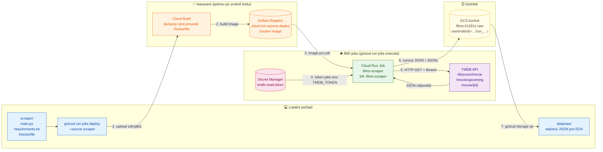

# films

Serverless aplikace nad daty o filmech z TMDB API, která běží na Google Cloud Platform.
Projekt nahrazuje starší Azure verzi (Databricks + ADLS), která je vypnutá, protože byla zbytečně složitá a drahá. Její kód je ve složce `old/` a slouží jen jako reference.

## Cílová architektura

```
TMDB API ──► Cloud Run Job (měsíčně, Cloud Scheduler)
                 │
                 ├─► GCS raw bucket (surový JSON)
                 └─► BigQuery staging ──MERGE──► BigQuery finální tabulka
                                                        │
Uživatel ──► Streamlit na Cloud Run ──► Gemini (function calling) ──► SQL nástroje ──┘

GitHub push ──► GitHub Actions ──► build image ──► deploy na Cloud Run
```

## Zdroje dat a filtry

Všechna data jsou z TMDB API. Parametry jsou v `scraper/config.toml` a celá konfigurace každého běhu je uložená v jeho `manifest.json`.

### Odkud se filmy berou

| | **Top 10k** | **Kina** | **Novinky** |
|---|---|---|---|
| Endpoint | `/movie/top_rated` | `/movie/now_playing` a `/movie/upcoming` | `/discover/movie` |
| Co obsahuje | nejlépe hodnocené filmy TMDB | co teď běží a co přijde do kin | nově vydané a chystané filmy (kino, streaming, festival) |
| **Filtry při stahování** (v API) | žádné vlastní. Řazení podle `vote_average` a minimální počet hlasů určuje TMDB, adult je vyřazený | `region` = **US, CZ** (země kina) | **země původu** (`with_origin_country`) = 23 zemí, **premiéra** od −30 do +90 dní od dne běhu, `include_adult=false`, `include_video=false` |
| Co se **nefiltruje** | země, rok, délka filmu | země původu (všechny filmy, které tam hrají), délka | délka filmu, počet hlasů, popularita |
| Rozsah | 500 stránek = max. 10 000 filmů | všechny stránky pro každý region | všechny stránky pro každou zemi. Pokud dotaz přesáhne 10 000 výsledků, rozsah dat se dělí |
| Režim | `full` (1× měsíčně) | `full` i `weekly` (1× týdně) | `full` i `weekly` (1× týdně) |
| Parametry v `config.toml` | `[top_rated] pages` | `[cinema] regions` | `[new_releases] countries, days_back, days_ahead, include_adult, include_video` |
| Značka v `_sources` | `top_rated` | `now_playing:US`, `upcoming:CZ` … | `new_release:FR` … |
| Filmů v 1. běhu (2026-10-26) | 9 922 | 774 unikátních (US běží 586 / přijde 116, CZ běží 76 / přijde 43) | 5 074 unikátních (US 2 302, FR 455, GB 382, DE 309, ES 275 …, SK 12) |

Země pro novinky (23): `US, GB, CA, AU, IE, NZ`, `CZ, SK`, `FR, DE, IT, ES, BE, NL, AT, CH, DK, SE, NO, FI, PL`, `KR, JP`. CN, IN a HK jsou vyřazené kvůli obrovské lokální produkci.

**Překryvy mezi zdroji (1. běh `full`):** 15 290 unikátních filmů. Jen v top 10k je 9 883 filmů, jen v novinkách 4 632, jen v kinech 297. Kina a novinky sdílejí 441 filmů, top 10k a kina 38, top 10k a novinky 3 (novinky ještě nemají dost hlasů na top 10k). Film ve více zdrojích se stahuje a ukládá jednou, všechny zdroje má v `_sources`.

### Co se děje s každým filmem

| Krok | Kde | Co |
|---|---|---|
| Sloučení | scraper | ID ze všech zdrojů se sloučí, duplicity se odstraní |
| Detail | scraper | `/movie/{id}?append_to_response=credits,keywords,release_dates` |
| Oříznutí `credits` | scraper | cast: prvních 20 herců podle `order`, crew: jen Director, Writer, Screenplay, Novel, Story, Producer, Executive Producer, Director of Photography, Original Music Composer, Editor, Casting (všichni lidé v roli). Ostatní pole beze změny |
| Přidaná pole | scraper | `_sources` (ze kterých zdrojů film přišel) a `_fetched_at` (čas stažení) |
| Uložení | GCS | JSONL po částech v `tmdb/mode=…/run=…/`, `manifest.json` jako poslední |
| Čištění | BigQuery (zatím nehotové) | `runtime ≥ 40`, `0` a prázdné hodnoty → `NULL`, typy, pole. V raw zůstává všechno |

## Rozhodnutí

- **Nejdřív lokálně, cloudové služby naostro.** Kód běží lokálně a volá skutečné služby v GCP (BigQuery, GCS, Gemini na Vertex AI). Na Cloud Run se později přesune stejný kód beze změn.
- **Gemini přes Vertex AI, ne přes AI Studio API klíč.** Přihlášení přes Application Default Credentials: lokálně `gcloud auth application-default login` (tvůj účet), na Cloud Runu service account. V kódu ani v `.env` nejsou žádné klíče.
  ```python
  from google import genai
  client = genai.Client(vertexai=True, project="<PROJECT_ID>", location="us-central1")
  ```
- **Žádné tajné údaje v repu.** TMDB klíč patří do Secret Manageru, GitHub Actions se přihlašují přes Workload Identity Federation (bez JSON klíče).
- **Náklady.** Region `us-central1` kvůli free tieru a budget alert hned při zakládání projektu. Volání Gemini se platí i při lokálním vývoji.
- **Jedno repo, oddělené CI/CD pro ETL a aplikaci.** GitHub repo je jediný zdroj pravdy pro kód. Každá část má vlastní workflow, které se spustí jen při změně jejích souborů:
  ```
  films/
  ├── scraper/                 ← ETL (Cloud Run Job)
  ├── app/                     ← Streamlit + Gemini (Cloud Run Service)
  ├── sql/                     ← BigQuery tabulky, MERGE
  └── .github/workflows/
      ├── deploy-scraper.yml   ← jen při změně scraper/**
      └── deploy-app.yml       ← jen při změně app/**
  ```
  ```yaml
  on:
    push:
      branches: [main]
      paths: ["scraper/**", ".github/workflows/deploy-scraper.yml"]
  ```
  - Části se nasazují nezávisle, takže chyba v buildu aplikace neblokuje ETL a naopak.
  - Schéma BigQuery, scraper i aplikace jsou v jednom repu, takže změna schématu je v jednom commitu.
  - Přihlášení GitHub Actions do GCP (Workload Identity Federation) se nastaví jednou pro celé repo.
  - Za běhu má každá část vlastní service account s minimálními právy: `films-scraper` (secret TMDB, zápis do bucketu) a `films-app` (čtení z BigQuery, Vertex AI). Aplikace k TMDB tokenu přístup nemá.
- **Strategie scrapingu: tři zdroje filmů a vždy plné stažení.** Původní plán (všechny filmy z vybraných zemí přes `discover`) se ukázal jako příliš velký: jen US od roku 1920 má přes 100 tisíc filmů, celkem odhadem 350–450 tisíc, většinou bez hlasů. Starý projekt pracoval s ~10 tisíci (Kaggle top 10k a upcoming). Nově se stahují tři zdroje (top 10k, kina a novinky), sloučí se podle `id` a ke každému filmu se stáhne detail. Přehled zdrojů, filtrů a čísel je v sekci [Zdroje dat a filtry](#zdroje-dat-a-filtry).

  - **Top 10k se mění pomalu** (hlasování uživatelů TMDB, nové filmy se do něj dostanou po měsících), proto stačí měsíčně. Kina a novinky se mění každý týden.
  - **Země pro novinky (23):** `US, GB, CA, AU, IE, NZ`, `CZ, SK`, `FR, DE, IT, ES, BE, NL, AT, CH, DK, SE, NO, FI, PL`, `KR, JP`. CN, IN a HK jsou vyřazené kvůli obrovské lokální produkci. Jejich světově známé filmy zachytí top 10k nebo kina v US.
  - **`release_dates`** obsahuje datum premiéry pro každou zemi a typ vydání (kino, digitál, TV), takže je známé, kdy film přijde do kin v ČR.
  - Každý detail má `_sources`, tedy ze kterých zdrojů film přišel (například `top_rated`, `now_playing:US`, `upcoming:CZ`, `new_release:FR`), a `_fetched_at`.
  - **Filtry ze starého projektu** (`runtime ≥ 40`, převod `0` a prázdných hodnot na `NULL`) se uplatní až při čištění v BigQuery. V raw zůstává všechno, co zdroje vrátily.
  - **Všechny parametry jsou v `scraper/config.toml`** (v repu, s komentáři): zdroje a režimy, regiony kin, země a okno novinek, oříznutí, výstup, API a pojistky. Změna = úprava souboru a nové nasazení jobu. Celá konfigurace se kopíruje do `manifest.json` každého běhu. Režim a testovací limity se nastavují proměnnými prostředí (`MODE`, `MAX_MOVIES`, `TOP_RATED_PAGES`).
  - **Oříznutí `credits` už ve scraperu**, všechno ostatní zůstane, jak to TMDB vrátilo: cast prvních 20 herců podle `order`, crew jen klíčové role (Director, Writer, Screenplay, Novel, Story, Producer, Executive Producer, Director of Photography, Original Music Composer, Editor, Casting) se všemi lidmi v roli.
  - **Scraper je nezávislý na BigQuery.** Jen stahuje do GCS a nic nečte ani nezapisuje do BigQuery.
- **Raw bucket: každý běh má vlastní složku a ukládá se po částech.**
  ```
  films-512811-raw/
  └── tmdb/                                   # zdroj dat (místo pro případné další zdroje)
      ├── mode=full/run=YYYY-MM-DDTHH-MM-SSZ/
      └── mode=weekly/run=YYYY-MM-DDTHH-MM-SSZ/
              lists/part-0001.jsonl     # surové stránky seznamů (se zdrojem a dotazem)
              details/part-0001.jsonl   # max. 1 000 filmů na část, nahrává se průběžně
              manifest.json             # zapisuje se jako poslední = běh je úplný
  ```
  Jen 4 úrovně. Prefix `raw/` by zdvojoval název bucketu a složka `dt=` by zdvojovala datum, které je v `run=`. Složky ve tvaru `klíč=hodnota` čte BigQuery automaticky jako sloupce `mode` a `run` (hive partitioning). Pole přidaná scraperem (`_sources`, `_fetched_at`) mají podtržítko, aby se odlišila od polí z TMDB.
  **Formát raw je JSONL, ne Parquet.** Je to přesná kopie odpovědi TMDB, nové nebo prázdné pole nezpůsobí konflikt schémat mezi částmi a scraper nepotřebuje `pyarrow`. Sloupcové uložení zajistí až nativní tabulky BigQuery. Pokud by objem dat byl větší, než se čeká, zapne se gzip (`.jsonl.gz`), který BigQuery čte přímo.

  Lifecycle pravidlo bucketu maže soubory starší než 160 dní, takže zůstává zhruba posledních 5 měsíčních běhů. Mazání řídí GCP, job nepotřebuje právo mazat.
- **Načítání do BigQuery čistě přes SQL.** External table nad raw bucketem a Scheduled Query (po každém běhu scraperu) vezme poslední úplný běh (s `manifest.json`), vyčistí ho a:
  - `MERGE` do `movies`: 1 řádek na film, aktuální stav (tabulka roste jen s počtem filmů, ne s počtem běhů) včetně aktuálních `sources`. `in_catalog = FALSE` dostanou jen filmy, které chybí v posledním **měsíčním** (`full`) běhu. Týdenní běh obsahuje jen kina a novinky, takže by jinak „vyřadil“ celý top 10k. Filmy se nemažou. Časové sloupce:
    - `first_seen_at`: první běh, ve kterém se film objevil. Nastaví se jednou a `MERGE` ho nikdy nepřepíše, takže „novinky v měsíci“ jdou filtrovat kdykoli zpětně. V prvním běhu ho dostanou všechny existující filmy, takže smysluplné novinky jsou až od druhého běhu.
    - `last_seen_at`: poslední běh, ve kterém film byl.
    - `updated_at`: kdy `MERGE` řádek naposledy změnil.
  - `INSERT` do `movie_snapshots`: 1 řádek na film a běh (`id, run_date, mode, sources, status, release_date, release_date_cz, vote_average, vote_count, popularity`). Slouží pro historii metrik, změny stavu (`Post Production` → `Released`), posuny premiér a historii kin (kdy film začal hrát a kdy zmizel, s týdenní přesností). Je to kolem 120–150 tisíc malých řádků ročně.
  - **`movie_snapshots` se nikdy nemaže ani nepřestavuje z raw.** Je to trvalý záznam historie, protože raw drží jen ~5 měsíců. Kdyby se `movies` přestavovala, `first_seen_at` se dopočítá jako `MIN(run_date)` ze snapshotů.
  - Opakované spuštění nic nerozbije, protože `MERGE` je idempotentní.

- **Kill switch přes GCP Spend caps (Billing → Budgets & caps), stejně jako u book_recommenderu.** GCP při dosažení měsíční částky sám pozastaví danou službu, bez vlastního kódu.
  - Omezení: jeden cap platí pro jeden projekt a jednu službu. Podporované jsou Cloud Run, Cloud Run Functions, Gemini API a Vertex AI. Vypnutí není okamžité, takže cap se nastavuje trochu pod skutečný limit a co se utratí navíc, se zaplatí.
  - **Cloud Run** (scraper, později aplikace): cap nastavit hned.
  - **Vertex AI** (Gemini): cap ve fázi II. Jestli jde v jednom projektu mít druhý budget s capem, se ověří v konzoli.
  - BigQuery, Cloud Storage a Cloud Build spend cap nemají. Jsou ve free tieru a hlídá je e-mailový alert v budgetu a `maximum_bytes_billed` u dotazů v BigQuery.
  - Ruční okamžité zastavení: **Cancel** u běžícího spuštění jobu v konzoli (nebo `gcloud run jobs executions cancel`). Vlastní skript na vypínání se nedělá, aby nevznikaly dva systémy vedle sebe.
  - Scraper má navíc vlastní pojistky (`max_runtime_minutes`, circuit breaker po opakovaných chybách), které chrání i TMDB API před zbytečnou zátěží.

## Roadmap

- [ ] **Fáze 0:** lokální prostředí (uv venv, struktura repa, `.gitignore`), GCP projekt (přihlášení přes `gcloud`, zapnutí API včetně `aiplatform.googleapis.com`, budget alert)
- [ ] **Fáze I:** GCS raw bucket, BigQuery dataset a tabulky, MERGE, extrakční job
  - [x] Secret, bucket a service account (krok 1.1)
  - [x] Vzorový scraping jako Cloud Run Job (krok 1.2)
  - [x] EDA surových dat (krok 1.3)
  - [x] Přepis scraperu podle strategie a test na jednom roce `CZ` (krok 1.4)
  - [x] Ostrý běh na `CZ` (krok 1.4)
  - [x] ~~Plný běh pro všech 26 zemí~~ zrušen po 14 minutách, katalog byl příliš velký (viz Rozhodnutí)
  - [x] Scraper se třemi zdroji (top 10k, kina US/CZ, novinky 23 zemí), režimy `full` a `weekly` (krok 1.5)
  - [x] Ostrý běh `weekly` a `full` (krok 1.5)
  - [ ] Lifecycle pravidlo bucketu (160 dní)
  - [ ] BigQuery: dataset `films`, external table, SQL pro cleaning
  - [ ] BigQuery: `movies` (`MERGE`) a `movie_snapshots` (`INSERT`)
  - [ ] Automatizace: Cloud Scheduler (scraper) a Scheduled Query (načtení)
  - [ ] Budget `films` se spend capem na Cloud Run a e-mailovými alerty
  - [x] Pojistky ve scraperu (`max_runtime_minutes`, circuit breaker) (krok 1.5)
- [ ] **Fáze II:** Streamlit aplikace a Gemini agent s function callingem nad BigQuery, vyvíjené lokálně proti Vertex AI v GCP
- [ ] **Fáze III:** Dockerfile a lokální test v kontejneru
- [ ] **Fáze IV:** CI/CD přes GitHub Actions a nasazení na Cloud Run

## Analýza starého scrapingu (`old/`)

| Skript | Endpoint | Co stahuje |
|---|---|---|
| `TMDB_films_api/api_TMDB_upcoming_films/extract_upcoming.ipynb`, `azure_pipeline_films/scrape_data.py` | `GET /movie/upcoming` (stránkování, `language=en-US`) | seznam chystaných filmů: `id, title, original_title, original_language, overview, release_date, popularity, vote_average, vote_count, genre_ids, poster_path, backdrop_path, adult, video` (zhruba 719 filmů) |
| totéž + `api_TMDB_released_films/extract_credits.ipynb` | `GET /movie/{id}?append_to_response=credits` (jeden dotaz na film) | `budget, revenue, runtime, tagline, genres[], production_companies[], production_countries[], spoken_languages[]`, `crew` jako slovník `{job: name}`, `cast[]` (jména) |
| `api_TMDB_released_films/input/10k_main.csv` | není ve skriptech (podle odkazů v notebooku z Kaggle) | 10 tisíc nejlépe hodnocených filmů včetně `Keywords` |

Zjištěné problémy, které se do nové verze nepřenesou:
- `scrape_data.py`: `return df` je uvnitř `while`, takže se stáhla jen první stránka `/movie/upcoming`.
- Při chybě se pokračuje s `data` z předchozího filmu, takže vznikají duplicity a chybná data (v `df_credits.csv` je například `id 1303578` dvakrát).
- `crew` jako `{job: name}` přepisuje lidi se stejnou rolí, z několika producentů zůstane jen poslední.
- Nekontroluje se HTTP status a chybí retry na `429` a `5xx`.
- `api_key` se posílá v URL a kód zároveň používá Bearer token.
- Data se zplošťují ještě před uložením, surová odpověď se nikde neuchovává.
- `vote_average` se přetypovává na `int`.

## Postup krok za krokem

Sem se zapisují jen kroky, které jsou skutečně hotové a ověřené.

### Krok 0.1 – Nástroje

- Region GCP: `us-central1` (kvůli free tieru GCS).
- `uv` 0.11.16 je nainstalovaný.
- Google Cloud SDK 590.0.1 (`gcloud`, `bq`, `gsutil`) je nainstalovaný přes winget:
  ```powershell
  winget install --id Google.CloudSDK --exact --source winget
  ```
  Instaluje se do `%LOCALAPPDATA%\Google\Cloud SDK\google-cloud-sdk\bin`. Po instalaci je potřeba úplně restartovat VS Code (ne jen otevřít nový terminál), aby se načetl `PATH`.

### Krok 0.3 – Lokální venv `uv_films`

Venv je mimo repo v `C:\Users\mabilek\uv_all_venvs\uv_films` (Python 3.12.10). Závislosti jsou v `pyproject.toml` a `uv.lock`. Slouží jen pro lokální práci (EDA, později Streamlit). Cloud Run Job ho nepoužívá, má vlastní `scraper/requirements.txt` v Docker image.

```powershell
uv venv C:\Users\mabilek\uv_all_venvs\uv_films --python 3.12
$env:UV_PROJECT_ENVIRONMENT = "C:\Users\mabilek\uv_all_venvs\uv_films"
uv init --bare --name films --python 3.12
uv add pandas pyarrow matplotlib ipykernel
```

`uv` jinak instaluje do `.venv` ve složce projektu. Proto se v každém novém terminálu nastaví `UV_PROJECT_ENVIRONMENT` (případně se venv aktivuje a použije `uv add --active` nebo `uv sync --active`):
```powershell
$env:UV_PROJECT_ENVIRONMENT = "C:\Users\mabilek\uv_all_venvs\uv_films"
uv sync
```
Ve VS Code se jako interpreter i kernel pro notebook vybere `C:\Users\mabilek\uv_all_venvs\uv_films\Scripts\python.exe`.

### Krok 0.2 – GCP projekt

- Projekt: `films-512811` (číslo projektu `188138853287`), billing je napojený.
- Přihlášení:
  ```bash
  gcloud auth login
  ```
  ADC (`gcloud auth application-default login`) zatím není potřeba. Scraping běží jen v Cloud Run Jobu pod service accountem a EDA se dělá nad staženými soubory. ADC se nastaví až ve chvíli, kdy bude lokální Python přímo volat GCP (Streamlit, Gemini).
- Výchozí konfigurace:
  ```bash
  gcloud config set project films-512811
  gcloud config set run/region us-central1
  ```
- Zapnutá API:
  ```bash
  gcloud services enable run.googleapis.com secretmanager.googleapis.com storage.googleapis.com artifactregistry.googleapis.com cloudbuild.googleapis.com
  ```
  BigQuery API je v novém projektu zapnuté automaticky.

### Krok 1.1 – Secret, bucket a service account pro scraping

- **Secret `tmdb-read-token`**: obsahuje TMDB API Read Access Token (Bearer). Vytváří se ručně v konzoli (Secret Manager → Create secret), aby se token nedostal do historie terminálu, do repa ani do chatu.
- **Bucket `gs://films-512811-raw`**: region `us-central1`, uniform bucket-level access, veřejný přístup zakázaný.
  ```bash
  gcloud storage buckets create gs://films-512811-raw --location=us-central1 --uniform-bucket-level-access --public-access-prevention
  ```
- **Service account `films-scraper@films-512811.iam.gserviceaccount.com`**: identita Cloud Run Jobu, s minimálními právy jen na konkrétní zdroje.
  ```bash
  gcloud iam service-accounts create films-scraper --display-name="Films TMDB scraper (Cloud Run Job)"
  gcloud secrets add-iam-policy-binding tmdb-read-token \
    --member=serviceAccount:films-scraper@films-512811.iam.gserviceaccount.com \
    --role=roles/secretmanager.secretAccessor
  gcloud storage buckets add-iam-policy-binding gs://films-512811-raw \
    --member=serviceAccount:films-scraper@films-512811.iam.gserviceaccount.com \
    --role=roles/storage.objectCreator
  ```
  `objectCreator` umí soubory jen vytvářet, ne číst ani mazat. To stačí, protože každý běh zapisuje nové soubory s časovým razítkem.

### Krok 1.2 – Scraping jako Cloud Run Job (vzorek dat)

Kód je ve složce `scraper/` (`main.py`, `requirements.txt`, `Dockerfile`).

- Stahuje `/discover/movie` (řazeno podle popularity, bez adult obsahu) a `/movie/upcoming`, z nich vybere unikátní ID a pro každé zavolá `/movie/{id}?append_to_response=credits,keywords`.
- Odpovědi ukládá **beze změn** do GCS:
  ```
  gs://films-512811-raw/raw/tmdb/dt=YYYY-MM-DD/run_YYYY-MM-DDTHH-MM-SSZ/
      discover_page_001.json    # surová stránka /discover/movie
      upcoming_page_001.json    # surová stránka /movie/upcoming
      movie_details.jsonl       # 1 řádek = 1 detail filmu včetně credits a keywords
      manifest.json             # metadata běhu (počty, chyby)
  ```
- Bearer token jde z Secret Manageru přes `--set-secrets`, takže v kódu ani v image žádný není. Při `429` a `5xx` se dotaz opakuje, film s chybou se zaloguje a přeskočí.
- Počet stránek se nastavuje proměnnými `DISCOVER_PAGES` a `UPCOMING_PAGES` (1 stránka = 20 filmů).

#### Jak funguje nasazení a běh jobu



- **Cloud Build** sestaví Docker image v cloudu, takže lokálně není potřeba Docker Desktop. Free tier je zhruba 2 500 build-minut měsíčně a jeden build trvá kolem 1 až 2 minut.
- **Artifact Registry** je úložiště Docker imagí. Repo `cloud-run-source-deploy` vytvoří `gcloud` automaticky při prvním nasazení. Free tier je 0,5 GB a staré verze imagí se hromadí, takže časem nastavíme jejich automatické mazání.
- Ve fázi IV bude kroky 1 až 3 dělat GitHub Actions při každém `git push`.

Nasazení (Cloud Build sestaví image z Dockerfile do Artifact Registry `cloud-run-source-deploy`):
```bash
gcloud run jobs deploy films-scraper --source scraper --region us-central1 \
  --service-account films-scraper@films-512811.iam.gserviceaccount.com \
  --set-secrets "TMDB_TOKEN=tmdb-read-token:latest" \
  --set-env-vars "BUCKET=films-512811-raw,DISCOVER_PAGES=1,UPCOMING_PAGES=1" \
  --max-retries 0 --task-timeout 15m
```

Spuštění, kontrola logů a stažení dat lokálně:
```bash
gcloud run jobs execute films-scraper --region us-central1 --wait
gcloud logging read 'resource.type="cloud_run_job" AND resource.labels.job_name="films-scraper"' --limit 30 --format="value(textPayload)"
gcloud storage cp -r gs://films-512811-raw/raw/tmdb data/raw/
```

První běh (2026-10-26) dopadl takto: 1 stránka discover a 1 stránka upcoming, tedy 40 filmů, z toho 31 unikátních. Detaily se stáhly u všech 31 a žádný neselhal. Data mají 1,37 MiB, z toho 1,4 MB je `movie_details.jsonl` (kolem 45 kB na film, většinu tvoří `credits`). Upcoming má v době běhu 88 stránek. Složky `data/` a `old/` jsou v `.gitignore`.

### Krok 1.3 – EDA surových dat

Notebook `eda/01_raw_tmdb.ipynb` (kernel `uv_films`) načte nejnovější běh z `data/raw/tmdb/` a projde manifest, oba seznamy filmů, ploché sloupce (null, prázdné a nulové hodnoty, rozdělení), vnořená pole, credits a keywords a velikost dat. Závěry jsou v poslední sekci notebooku.

Hlavní zjištění ze vzorku 31 filmů:
- `/movie/upcoming` bez `region` vrací hlavně už vydané filmy (jen 2 z 20 jsou po dni běhu).
- `/discover/movie` hlásí 1001 stránek, ale TMDB vrací nejvýš 500, takže plný katalog je potřeba stahovat po řezech (například po letech).
- `budget` a `revenue` = 0 (9 z 31) a `vote_average` = 0 při `vote_count` = 0 znamenají „neznámé“, tedy `NULL`. Prázdné `tagline` a `homepage` také → `NULL`.
- `credits` tvoří 96 % objemu (44 kB na film, z toho 76 % crew s 384 různými joby). Do BigQuery půjdou jen klíčové role jako `ARRAY` na roli (až 2 režiséři, až 12 producentů) a prvních N herců podle `order`.
- `adult`, `video` a `softcore` jsou vždy `False`, takže se vynechají.

Do venv přibyly dev závislosti `nbclient` a `nbformat` pro spuštění notebooku z příkazové řádky (`uv add --dev nbclient nbformat`).

### Krok 1.4 – Scraper podle strategie, test na `CZ`

Scraper (`scraper/main.py`) je přepsaný podle sekce Rozhodnutí. Všechny parametry jsou v `scraper/config.toml` s komentáři:
- `[discover]`: země, `min_runtime`, `year_from`, `years_ahead`, adult/video, jazyk textů,
- `[trim]`: `cast_top_n` a `crew_jobs`,
- `[output]`: prefix, velikost částí, gzip,
- `[api]`: `workers` a `max_requests_per_second`.

Jak scraper funguje:
- Pro každou zemi stáhne `/discover/movie` přes celý rozsah dat vydání. Pokud má rozsah víc než 10 000 výsledků (limit TMDB), rozdělí ho napůl a pokračuje, dokud se nevejde.
- Detaily stahuje paralelně (8 vláken) se společným stropem 30 dotazů za sekundu a při `429` nebo `5xx` dotaz zopakuje.
- Výstup nahrává průběžně po částech. Každý detail má pole `_fetched_at`. Celá konfigurace a počty jdou do `manifest.json`.

Nasazení (`--task-timeout 6h`, `--memory 1Gi`) a testovací spuštění s přepsanými parametry:
```bash
gcloud run jobs deploy films-scraper --source scraper --region us-central1 \
  --service-account films-scraper@films-512811.iam.gserviceaccount.com \
  --set-secrets "TMDB_TOKEN=tmdb-read-token:latest" --set-env-vars "BUCKET=films-512811-raw" \
  --max-retries 0 --task-timeout 6h --memory 1Gi
gcloud run jobs execute films-scraper --region us-central1 --update-env-vars "COUNTRIES=CZ,YEAR_FROM=2024,YEAR_TO=2024" --wait
gcloud run jobs execute films-scraper --region us-central1 --update-env-vars "COUNTRIES=CZ" --async
```

Výsledky (2026-10-26):
| Běh | Filmů | Chyb | Doba | details | lists |
|---|---|---|---|---|---|
| CZ 2024 | 145 | 0 | 6 s | 1 soubor, 0,77 MB | 1 soubor, 0,11 MB |
| CZ 1900–2028 | 2 910 | 0 | 115 s | 3 soubory, 16,6 MB (~5,7 kB na film) | 1 soubor, 2,1 MB |

Oříznutí credits ověřené na vzorku z kroku 1.2: z 44,3 kB na 12,2 kB na film u populárních filmů. U celého CZ katalogu je to ~5,7 kB na film, protože méně známé filmy mají menší štáb.

### Krok 1.5 – Scraper se třemi zdroji, režimy `full` a `weekly`

Plný běh přes `discover` pro 26 zemí od roku 1920 byl po 14 minutách zrušen (`gcloud run jobs executions cancel`): jen US do roku 2011 dalo ~107 tisíc filmů, celkový odhad byl 350–450 tisíc a hrozilo překročení časového limitu jobu. Strategie se změnila na tři zdroje (viz Rozhodnutí): top 10k, kina US/CZ a novinky z 23 zemí. Testovací a zrušené běhy jsou z bucketu smazané.

Scraper (`scraper/main.py`, `scraper/config.toml`):
- `[modes]` určuje, které zdroje se stahují v režimu `full` a `weekly`. Režim se volí proměnnou `MODE`.
- Detail se stahuje s `append_to_response=credits,keywords,release_dates`. Každý film má `_sources` a `_fetched_at`.
- Pojistky `[safety]`: `max_runtime_minutes = 120` a `max_consecutive_failures = 50`. Při překročení se běh ukončí bez `manifest.json`.
- Cesta v bucketu: `tmdb/mode=…/run=…/` (oba běhy z 2026-10-26 jsou přesunuté ze staršího tvaru `raw/tmdb/mode=…/dt=…/run=…/` přes `gcloud storage mv` a jejich manifesty mají opravené cesty).

```bash
gcloud run jobs deploy films-scraper --source scraper --region us-central1 \
  --service-account films-scraper@films-512811.iam.gserviceaccount.com \
  --set-secrets "TMDB_TOKEN=tmdb-read-token:latest" --set-env-vars "BUCKET=films-512811-raw" \
  --max-retries 0 --task-timeout 3h --memory 1Gi
gcloud run jobs execute films-scraper --region us-central1 --update-env-vars "MODE=weekly" --wait
gcloud run jobs execute films-scraper --region us-central1 --update-env-vars "MODE=full" --async
```

Výsledky (2026-10-26):
| Běh | Filmů (unikátních) | Chyb | Doba | Velikost | Souborů |
|---|---|---|---|---|---|
| `weekly` | 5 407 | 0 | 3,5 min | ~29 MB (~4,7 kB na film v detailech) | 7 + manifest |
| `full` | 15 290 | 0 | 9,5 min | 204 MB (~13 kB na film) | 18 + manifest |

Filmy podle zdroje: top 10k 9 922 (TMDB během stránkování mírně přeřazuje pořadí, proto méně než 10 000), kina: US běží 586 / přijde 116, CZ běží 76 / přijde 43, novinky (−30 až +90 dní) celkem 5 278, z toho US 2 302, FR 455, GB 382, DE 309, ES 275, CA 229, IT 227, JP 177, NL 150, KR 139, AU 119, CZ 81, BE 81, PL 61, SE 56, CH 51, IE 42, AT 31, NO 26, FI 26, DK 24, NZ 23, SK 12.

**Druhý bucket `run-sources-films-512811-us-central1`** vytvořil automaticky `gcloud run jobs deploy --source`. Ukládá zazipované zdrojáky z každého nasazení (~16 kB), ze kterých Cloud Build sestaví image. Nemazat, `gcloud` ho používá při každém nasazení.
