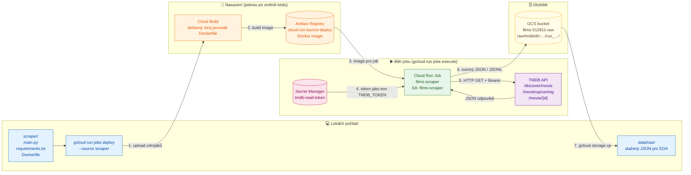

# films

Serverless aplikace nad daty o filmech z TMDB API, která běží na Google Cloud Platform.
Projekt nahrazuje starší Azure verzi (Databricks + ADLS), která je vypnutá, protože byla zbytečně složitá a drahá. Její kód je ve složce `old/` a slouží jen jako reference.

## Cílová architektura

```
TMDB API ──► Cloud Run Job (měsíčně, Cloud Scheduler)
                 │
                 ├─► GCS raw bucket (surový JSON)
                 └─► BigQuery staging ──MERGE──► BigQuery finální tabulka
                                                        │
Uživatel ──► Streamlit na Cloud Run ──► Gemini (function calling) ──► SQL nástroje ──┘

GitHub push ──► GitHub Actions ──► build image ──► deploy na Cloud Run
```

## Rozhodnutí

- **Nejdřív lokálně, cloudové služby naostro.** Kód běží lokálně a volá skutečné služby v GCP (BigQuery, GCS, Gemini na Vertex AI). Na Cloud Run se později přesune stejný kód beze změn.
- **Gemini přes Vertex AI, ne přes AI Studio API klíč.** Přihlášení přes Application Default Credentials: lokálně `gcloud auth application-default login` (tvůj účet), na Cloud Runu service account. V kódu ani v `.env` nejsou žádné klíče.
  ```python
  from google import genai
  client = genai.Client(vertexai=True, project="<PROJECT_ID>", location="us-central1")
  ```
- **Žádné tajné údaje v repu.** TMDB klíč patří do Secret Manageru, GitHub Actions se přihlašují přes Workload Identity Federation (bez JSON klíče).
- **Náklady.** Region `us-central1` kvůli free tieru a budget alert hned při zakládání projektu. Volání Gemini se platí i při lokálním vývoji.
- **Jedno repo, oddělené CI/CD pro ETL a aplikaci.** GitHub repo je jediný zdroj pravdy pro kód. Každá část má vlastní workflow, které se spustí jen při změně jejích souborů:
  ```
  films/
  ├── scraper/                 ← ETL (Cloud Run Job)
  ├── app/                     ← Streamlit + Gemini (Cloud Run Service)
  ├── sql/                     ← BigQuery tabulky, MERGE
  └── .github/workflows/
      ├── deploy-scraper.yml   ← jen při změně scraper/**
      └── deploy-app.yml       ← jen při změně app/**
  ```
  ```yaml
  on:
    push:
      branches: [main]
      paths: ["scraper/**", ".github/workflows/deploy-scraper.yml"]
  ```
  - Části se nasazují nezávisle, takže chyba v buildu aplikace neblokuje ETL a naopak.
  - Schéma BigQuery, scraper i aplikace jsou v jednom repu, takže změna schématu je v jednom commitu.
  - Přihlášení GitHub Actions do GCP (Workload Identity Federation) se nastaví jednou pro celé repo.
  - Za běhu má každá část vlastní service account s minimálními právy: `films-scraper` (secret TMDB, zápis do bucketu) a `films-app` (čtení z BigQuery, Vertex AI). Aplikace k TMDB tokenu přístup nemá.
- **Strategie scrapingu: každý měsíc plné stažení katalogu.** S filtry a oříznutím vychází zhruba 12 kB na film, takže plné stažení je levné a jednodušší než přírůstky. Smazané filmy, opravy chyb i změny nastavení se projeví samy.
  - **Filtry přímo v API** (`/discover/movie`): `include_adult=false`, `include_video=false`, `with_runtime.gte=40` (oficiální hranice celovečerního filmu podle AMPAS a BFI; vyřadí i filmy s neznámou délkou) a `with_origin_country` podle seznamu zemí. Stahují se **všechny filmy** z vybraných zemí bez prahu `vote_count`. Méně známé filmy se filtrují až v BigQuery nebo v aplikaci podle `vote_count`. Katalog se prochází po zemích a letech (TMDB vrací nejvýš 500 stránek, tedy 10 000 filmů na dotaz). Rok, který se do limitu nevejde, se dělí na měsíce. Duplicity se sloučí podle `id`. Jazyk se nefiltruje, `original_language` zůstává jako sloupec.
  - **Výchozí seznam zemí (27):** `US, GB, CA, AU, IE, NZ`, `CZ, SK`, `FR, DE, IT, ES, BE, NL, AT, CH, DK, SE, NO, FI, PL`, `KR, JP, CN, HK, IN`. Dá se kdykoli změnit a další měsíční běh se tomu přizpůsobí.
  - **Všechny parametry jsou v `scraper/config.toml`** (v repu, s komentáři), rozdělené na `[discover]` (které filmy), `[trim]` (co z filmu uložit) a `[output]` (jak ukládat). Změna = úprava souboru a nové nasazení jobu. Celá konfigurace se kopíruje do `manifest.json` každého běhu. Pro jednorázové testy jde parametr přepsat proměnnou prostředí (například `COUNTRIES=CZ`).
  - **Oříznutí `credits` už ve scraperu**, všechno ostatní zůstane, jak to TMDB vrátilo: cast prvních 20 herců podle `order`, crew jen klíčové role (Director, Writer, Screenplay, Novel, Story, Producer, Executive Producer, Director of Photography, Original Music Composer, Editor, Casting) se všemi lidmi v roli. Pravidla oříznutí se zapisují do `manifest.json` každého běhu.
  - **Scraper je nezávislý na BigQuery.** Jen stahuje do GCS a nic nečte ani nezapisuje do BigQuery.
- **Raw bucket: každý běh má vlastní složku a ukládá se po částech.**
  ```
  raw/tmdb/dt=YYYY-MM-DD/run_…/
      lists/part-0001.jsonl      # surové stránky seznamů
      details/part-0001.jsonl    # max. 1 000 filmů na část, nahrává se průběžně
      manifest.json              # zapisuje se jako poslední = běh je úplný
  ```
  **Formát raw je JSONL, ne Parquet.** Je to přesná kopie odpovědi TMDB, nové nebo prázdné pole nezpůsobí konflikt schémat mezi částmi a scraper nepotřebuje `pyarrow`. Sloupcové uložení zajistí až nativní tabulky BigQuery. Pokud by objem dat byl větší, než se čeká, zapne se gzip (`.jsonl.gz`), který BigQuery čte přímo.

  Lifecycle pravidlo bucketu maže soubory starší než 160 dní, takže zůstává zhruba posledních 5 měsíčních běhů. Mazání řídí GCP, job nepotřebuje právo mazat.
- **Načítání do BigQuery čistě přes SQL.** External table nad raw bucketem a Scheduled Query jednou měsíčně (po scraperu) vezme poslední úplný běh (s `manifest.json`), vyčistí ho a:
  - `MERGE` do `movies`: 1 řádek na film, aktuální stav. Filmy, které v běhu chybí (například z odebrané země), dostanou `in_catalog = FALSE` a nemažou se.
  - `INSERT` do `movie_metrics_history`: `vote_average`, `vote_count` a `popularity` za každý běh, aby historie metrik přežila mazání raw.
  - Opakované spuštění nic nerozbije, protože `MERGE` je idempotentní.

## Roadmap

- [ ] **Fáze 0:** lokální prostředí (uv venv, struktura repa, `.gitignore`), GCP projekt (přihlášení přes `gcloud`, zapnutí API včetně `aiplatform.googleapis.com`, budget alert)
- [ ] **Fáze I:** GCS raw bucket, BigQuery dataset a tabulky, MERGE, extrakční job
  - [x] Secret, bucket a service account (krok 1.1)
  - [x] Vzorový scraping jako Cloud Run Job (krok 1.2)
  - [x] EDA surových dat (krok 1.3)
  - [ ] Přepis scraperu podle strategie a test na jednom roce `CZ`
  - [ ] Ostrý běh na `CZ` (skutečný objem a doba běhu)
  - [ ] Plný běh pro všech 27 zemí
  - [ ] Lifecycle pravidlo bucketu (160 dní)
  - [ ] BigQuery: dataset `films`, external table, SQL pro cleaning
  - [ ] BigQuery: `movies` (`MERGE`) a `movie_metrics_history` (`INSERT`)
  - [ ] Automatizace: Cloud Scheduler (scraper) a Scheduled Query (načtení)
  - [ ] Budget alert
- [ ] **Fáze II:** Streamlit aplikace a Gemini agent s function callingem nad BigQuery, vyvíjené lokálně proti Vertex AI v GCP
- [ ] **Fáze III:** Dockerfile a lokální test v kontejneru
- [ ] **Fáze IV:** CI/CD přes GitHub Actions a nasazení na Cloud Run

## Analýza starého scrapingu (`old/`)

| Skript | Endpoint | Co stahuje |
|---|---|---|
| `TMDB_films_api/api_TMDB_upcoming_films/extract_upcoming.ipynb`, `azure_pipeline_films/scrape_data.py` | `GET /movie/upcoming` (stránkování, `language=en-US`) | seznam chystaných filmů: `id, title, original_title, original_language, overview, release_date, popularity, vote_average, vote_count, genre_ids, poster_path, backdrop_path, adult, video` (zhruba 719 filmů) |
| totéž + `api_TMDB_released_films/extract_credits.ipynb` | `GET /movie/{id}?append_to_response=credits` (jeden dotaz na film) | `budget, revenue, runtime, tagline, genres[], production_companies[], production_countries[], spoken_languages[]`, `crew` jako slovník `{job: name}`, `cast[]` (jména) |
| `api_TMDB_released_films/input/10k_main.csv` | není ve skriptech (podle odkazů v notebooku z Kaggle) | 10 tisíc nejlépe hodnocených filmů včetně `Keywords` |

Zjištěné problémy, které se do nové verze nepřenesou:
- `scrape_data.py`: `return df` je uvnitř `while`, takže se stáhla jen první stránka `/movie/upcoming`.
- Při chybě se pokračuje s `data` z předchozího filmu, takže vznikají duplicity a chybná data (v `df_credits.csv` je například `id 1303578` dvakrát).
- `crew` jako `{job: name}` přepisuje lidi se stejnou rolí, z několika producentů zůstane jen poslední.
- Nekontroluje se HTTP status a chybí retry na `429` a `5xx`.
- `api_key` se posílá v URL a kód zároveň používá Bearer token.
- Data se zplošťují ještě před uložením, surová odpověď se nikde neuchovává.
- `vote_average` se přetypovává na `int`.

## Postup krok za krokem

Sem se zapisují jen kroky, které jsou skutečně hotové a ověřené.

### Krok 0.1 – Nástroje

- Region GCP: `us-central1` (kvůli free tieru GCS).
- `uv` 0.11.16 je nainstalovaný.
- Google Cloud SDK 590.0.1 (`gcloud`, `bq`, `gsutil`) je nainstalovaný přes winget:
  ```powershell
  winget install --id Google.CloudSDK --exact --source winget
  ```
  Instaluje se do `%LOCALAPPDATA%\Google\Cloud SDK\google-cloud-sdk\bin`. Po instalaci je potřeba úplně restartovat VS Code (ne jen otevřít nový terminál), aby se načetl `PATH`.

### Krok 0.3 – Lokální venv `uv_films`

Venv je mimo repo v `C:\Users\mabilek\uv_all_venvs\uv_films` (Python 3.12.10). Závislosti jsou v `pyproject.toml` a `uv.lock`. Slouží jen pro lokální práci (EDA, později Streamlit). Cloud Run Job ho nepoužívá, má vlastní `scraper/requirements.txt` v Docker image.

```powershell
uv venv C:\Users\mabilek\uv_all_venvs\uv_films --python 3.12
$env:UV_PROJECT_ENVIRONMENT = "C:\Users\mabilek\uv_all_venvs\uv_films"
uv init --bare --name films --python 3.12
uv add pandas pyarrow matplotlib ipykernel
```

`uv` jinak instaluje do `.venv` ve složce projektu. Proto se v každém novém terminálu nastaví `UV_PROJECT_ENVIRONMENT` (případně se venv aktivuje a použije `uv add --active` nebo `uv sync --active`):
```powershell
$env:UV_PROJECT_ENVIRONMENT = "C:\Users\mabilek\uv_all_venvs\uv_films"
uv sync
```
Ve VS Code se jako interpreter i kernel pro notebook vybere `C:\Users\mabilek\uv_all_venvs\uv_films\Scripts\python.exe`.

### Krok 0.2 – GCP projekt

- Projekt: `films-512811` (číslo projektu `188138853287`), billing je napojený.
- Přihlášení:
  ```bash
  gcloud auth login
  ```
  ADC (`gcloud auth application-default login`) zatím není potřeba. Scraping běží jen v Cloud Run Jobu pod service accountem a EDA se dělá nad staženými soubory. ADC se nastaví až ve chvíli, kdy bude lokální Python přímo volat GCP (Streamlit, Gemini).
- Výchozí konfigurace:
  ```bash
  gcloud config set project films-512811
  gcloud config set run/region us-central1
  ```
- Zapnutá API:
  ```bash
  gcloud services enable run.googleapis.com secretmanager.googleapis.com storage.googleapis.com artifactregistry.googleapis.com cloudbuild.googleapis.com
  ```
  BigQuery API je v novém projektu zapnuté automaticky.

### Krok 1.1 – Secret, bucket a service account pro scraping

- **Secret `tmdb-read-token`**: obsahuje TMDB API Read Access Token (Bearer). Vytváří se ručně v konzoli (Secret Manager → Create secret), aby se token nedostal do historie terminálu, do repa ani do chatu.
- **Bucket `gs://films-512811-raw`**: region `us-central1`, uniform bucket-level access, veřejný přístup zakázaný.
  ```bash
  gcloud storage buckets create gs://films-512811-raw --location=us-central1 --uniform-bucket-level-access --public-access-prevention
  ```
- **Service account `films-scraper@films-512811.iam.gserviceaccount.com`**: identita Cloud Run Jobu, s minimálními právy jen na konkrétní zdroje.
  ```bash
  gcloud iam service-accounts create films-scraper --display-name="Films TMDB scraper (Cloud Run Job)"
  gcloud secrets add-iam-policy-binding tmdb-read-token \
    --member=serviceAccount:films-scraper@films-512811.iam.gserviceaccount.com \
    --role=roles/secretmanager.secretAccessor
  gcloud storage buckets add-iam-policy-binding gs://films-512811-raw \
    --member=serviceAccount:films-scraper@films-512811.iam.gserviceaccount.com \
    --role=roles/storage.objectCreator
  ```
  `objectCreator` umí soubory jen vytvářet, ne číst ani mazat. To stačí, protože každý běh zapisuje nové soubory s časovým razítkem.

### Krok 1.2 – Scraping jako Cloud Run Job (vzorek dat)

Kód je ve složce `scraper/` (`main.py`, `requirements.txt`, `Dockerfile`).

- Stahuje `/discover/movie` (řazeno podle popularity, bez adult obsahu) a `/movie/upcoming`, z nich vybere unikátní ID a pro každé zavolá `/movie/{id}?append_to_response=credits,keywords`.
- Odpovědi ukládá **beze změn** do GCS:
  ```
  gs://films-512811-raw/raw/tmdb/dt=YYYY-MM-DD/run_YYYY-MM-DDTHH-MM-SSZ/
      discover_page_001.json    # surová stránka /discover/movie
      upcoming_page_001.json    # surová stránka /movie/upcoming
      movie_details.jsonl       # 1 řádek = 1 detail filmu včetně credits a keywords
      manifest.json             # metadata běhu (počty, chyby)
  ```
- Bearer token jde z Secret Manageru přes `--set-secrets`, takže v kódu ani v image žádný není. Při `429` a `5xx` se dotaz opakuje, film s chybou se zaloguje a přeskočí.
- Počet stránek se nastavuje proměnnými `DISCOVER_PAGES` a `UPCOMING_PAGES` (1 stránka = 20 filmů).

#### Jak funguje nasazení a běh jobu



- **Cloud Build** sestaví Docker image v cloudu, takže lokálně není potřeba Docker Desktop. Free tier je zhruba 2 500 build-minut měsíčně a jeden build trvá kolem 1 až 2 minut.
- **Artifact Registry** je úložiště Docker imagí. Repo `cloud-run-source-deploy` vytvoří `gcloud` automaticky při prvním nasazení. Free tier je 0,5 GB a staré verze imagí se hromadí, takže časem nastavíme jejich automatické mazání.
- Ve fázi IV bude kroky 1 až 3 dělat GitHub Actions při každém `git push`.

Nasazení (Cloud Build sestaví image z Dockerfile do Artifact Registry `cloud-run-source-deploy`):
```bash
gcloud run jobs deploy films-scraper --source scraper --region us-central1 \
  --service-account films-scraper@films-512811.iam.gserviceaccount.com \
  --set-secrets "TMDB_TOKEN=tmdb-read-token:latest" \
  --set-env-vars "BUCKET=films-512811-raw,DISCOVER_PAGES=1,UPCOMING_PAGES=1" \
  --max-retries 0 --task-timeout 15m
```

Spuštění, kontrola logů a stažení dat lokálně:
```bash
gcloud run jobs execute films-scraper --region us-central1 --wait
gcloud logging read 'resource.type="cloud_run_job" AND resource.labels.job_name="films-scraper"' --limit 30 --format="value(textPayload)"
gcloud storage cp -r gs://films-512811-raw/raw/tmdb data/raw/
```

První běh (2026-10-26) dopadl takto: 1 stránka discover a 1 stránka upcoming, tedy 40 filmů, z toho 31 unikátních. Detaily se stáhly u všech 31 a žádný neselhal. Data mají 1,37 MiB, z toho 1,4 MB je `movie_details.jsonl` (kolem 45 kB na film, většinu tvoří `credits`). Upcoming má v době běhu 88 stránek. Složky `data/` a `old/` jsou v `.gitignore`.

### Krok 1.3 – EDA surových dat

Notebook `eda/01_raw_tmdb.ipynb` (kernel `uv_films`) načte nejnovější běh z `data/raw/tmdb/` a projde manifest, oba seznamy filmů, ploché sloupce (null, prázdné a nulové hodnoty, rozdělení), vnořená pole, credits a keywords a velikost dat. Závěry jsou v poslední sekci notebooku.

Hlavní zjištění ze vzorku 31 filmů:
- `/movie/upcoming` bez `region` vrací hlavně už vydané filmy (jen 2 z 20 jsou po dni běhu).
- `/discover/movie` hlásí 1001 stránek, ale TMDB vrací nejvýš 500, takže plný katalog je potřeba stahovat po řezech (například po letech).
- `budget` a `revenue` = 0 (9 z 31) a `vote_average` = 0 při `vote_count` = 0 znamenají „neznámé“, tedy `NULL`. Prázdné `tagline` a `homepage` také → `NULL`.
- `credits` tvoří 96 % objemu (44 kB na film, z toho 76 % crew s 384 různými joby). Do BigQuery půjdou jen klíčové role jako `ARRAY` na roli (až 2 režiséři, až 12 producentů) a prvních N herců podle `order`.
- `adult`, `video` a `softcore` jsou vždy `False`, takže se vynechají.

Do venv přibyly dev závislosti `nbclient` a `nbformat` pro spuštění notebooku z příkazové řádky (`uv add --dev nbclient nbformat`).
